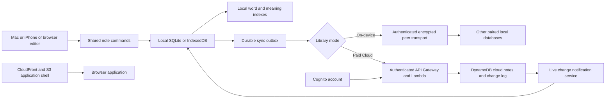

# Peel product and technical specification

Version 0.7 | 26 October 2026 | Implementation in progress

This is the canonical behavior and implementation contract for Peel. [PRFAQ.md](PRFAQ.md) defines the customer promise. Requirement IDs remain stable as this specification evolves. Implementation was authorized on 26 October. Current evidence and remaining gates live in [features/local-mac-app.md](features/local-mac-app.md); targets below remain acceptance targets until measured.

## Product scope

Build a personal note app with fast floating notes on Mac, a searchable library, two app-wide saving modes, and access through an iPhone app and the browser. Free On-device mode stores notes only on devices and periodically synchronizes paired devices, including remotely. Paid Peel Cloud stores the complete library in Amazon DynamoDB and synchronizes connected devices live. Capture, local saving, and word search must work without a network connection. The first user is Sandip; the architecture must also support unrelated public users without access to one another's notes.

Confirmed decisions: the app is Peel; iPhone comes first and Android uses the web app. Mac is the only native desktop target.

### Delivery stages

| Stage | Deliverable | Exit condition |
| --- | --- | --- |
| M0 | Feasibility and performance experiments | Resolve the technical gates below before committing to the shell, sync layout, or model |
| M1 | Local Mac dogfood app | Capture, durable autosave, formatting, tags, lifecycle, word search, import and export pass |
| M2 | Remote periodic peer sync, paid live Cloud, and web app | Peer convergence, no server-stored peer notes, entitlement, live delivery, offline recovery, reconnect, and initial download tests pass |
| M3 | iPhone app | Native persistence, authentication, lifecycle interruption, touch editing, and Mac/web parity pass |
| M4 | Search by meaning | Local inference meets quality and performance gates on Mac, iPhone, and web |
| M5 | Public beta and launch readiness | All public requirements pass, 14 days of dogfooding complete, distribution and operating requirements met |

M4 experiments start in M0; the feature must not delay M1 capture work. All ten items in the original brief remain in public v1. The modes are free On-device with remote periodic peer sync, and paid Peel Cloud operated in Sandip’s AWS account using DynamoDB. A local-only build is an intermediate step, not the completed free mode. Google Drive integration is excluded.

## Functional requirements

| ID | Required behavior | Stage |
| --- | --- | --- |
| FR-01 | Create a focused blank note with one action. Mac supports a configurable global shortcut, menu bar action, and library action. | M1 |
| FR-02 | Save changes automatically to durable local storage. Closing a native note waits for the final local save and keeps the note in the library. | M1 |
| FR-03 | Offer two app-wide library modes: free On-device and paid Peel Cloud. Switching to Cloud explicitly authorizes upload of the complete library. No per-note destination picker. | M1 local; M2 modes |
| FR-04 | Store the entire Cloud-mode library through an authenticated API in app-managed DynamoDB. Cache it locally, accept offline edits, and deliver updates live to connected devices. | M2 |
| FR-05 | Provide a Mac app, browser app including Android, and native iPhone app with the same note content and lifecycle behavior. | M1 to M3 |
| FR-06 | Search locally by words and tags; add an optional local search by meaning that returns source notes and excerpts. | M1 words; M4 meaning |
| FR-07 | Edit, archive, unarchive, move to Trash, restore, and permanently delete notes. | M1 |
| FR-08 | Render cached notes and accept typing without waiting for authentication, cloud requests, analytics, or an AI model. Meet the performance budgets below. | All |
| FR-09 | Parse inline tags beginning with `##` and expose tag filtering. | M1 |
| FR-10 | Support only one Markdown heading level, bold, task checkboxes, bullets, and ordered lists, with lossless source storage. | M1 |
| FR-11 | Make independent, draggable top-level Mac note windows the primary desktop experience. Each lives outside the separate Notes Library and has one top-left green minus (Put away) control that saves locally before closing. | M1 |
| FR-12 | Export portable Markdown plus metadata and import that format without duplicating matching note revisions. | M1 |
| FR-13 | Expose separate local-save and mode-specific sync states. Recover interrupted writes and transitions. On-device sync applies the latest edit automatically with optional local version recovery; Cloud preserves concurrent offline drafts for resolution. | M1 local; M2 sync |
| FR-14 | Keep unrelated users and Peel accounts isolated. Keep note text, queries, tags, and tokens out of telemetry. | All |
| FR-15 | Pin a note to the desktop by dragging it out of the Notes Library or choosing Pin to desktop from its right-click menu. Keep one note identity and unchanged storage. | M1 |
| FR-16 | Arrange open notes along the left, right, top, or bottom edge using configurable shortcuts and Window menu commands. Offer Undo last arrangement. | M1 |
| FR-17 | Pair trusted devices and periodically sync On-device notes over direct encrypted connections or transient relays across different networks. Store no note payload on servers. | M2; iPhone M3 |
| FR-18 | Require a server-verified paid entitlement for Cloud. Keep On-device capture, peer sync, search and export available without a subscription. | M2 |
| FR-19 | Converge On-device notes by deterministic latest-edit ordering, independent of message/retry order. Keep replaced content locally for seven days and reject resurrection of purged IDs. | M2 |
| FR-20 | Push committed Cloud changes to active connected devices in real time; reconcile offline/suspended clients on return. | M2 |

The baseline excludes attachments, reminders, collaboration, live cursors, arbitrary rich text, generated AI answers, native Android, Windows, Linux, and automatic Google Keep import.

## Interaction contract

### Capture and windows

The proposed Mac shortcut is Control Option N. Detect registration failure and let the user choose another shortcut. The menu bar process stays resident after the last note closes; Quit is a separate action. Launch at login is an explicit preference. A shortcut works while the app is running; operating-system launch behavior is not assumed.

Launch at login reads the Mac's current login-item status and changes only after an explicit Settings action. Never register automatically on install/startup or silently re-enable a login item disabled in System Settings. Show pending approval separately from enabled, refresh on return to Peel, and preserve the observed state on failure. Turning it off leaves the current app and notes running. Development executables and isolated test libraries cannot change login items. Verify registration, approval, disable and actual login/relaunch with the installed signed app before treating this behavior as accepted.

An action creates a new note ID, uses the library’s selected mode, and focuses an empty editor. A missing cloud connection does not silently switch mode: keep changes locally, show Waiting to sync, and offer reconnection or the explicit whole-library mode transition. No account or title prompt interrupts On-device capture.

Floating notes are the primary Mac surface. On launch, restore the person's pinned desktop notes; opening Peel does not require opening the library. New Note creates a note directly in its own floating window. Each note has at most one such window per Mac; opening an already visible note brings that window forward.

Each desktop note is an independent top-level macOS window, outside the Notes Library's bounds and view hierarchy. Closing, minimizing, or moving the library must not close, minimize, clip, or move its floating notes. They remain visible on the desktop while the library is closed. The desktop scene in the mockup is wallpaper and OS context, not a larger Peel window containing the notes. Native window independence must be established in M0.

The note title bar has exactly one control: a green circle with a minus at the top left, called Put away. It performs the existing save-and-close action and keeps the note in the library. Do not add other minimize, maximize/fullscreen, pin, overflow, or always-on-top controls in that title bar. The remaining area is a drag handle. Keep on top, source view, and lifecycle/storage actions are available through right-click or app menus. The normal desktop note omits a persistent formatting toolbar and uses a quiet, noninteractive save/mode footer; Markdown editing remains available in the body. Save failures may expose recovery actions in the note body.

Open Notes Library shows a separate, resizable full library window. Provide the action in the menu bar, the Window menu, and the desktop mockup's library control. Command Shift L is the proposed app-level library shortcut. The library shows all notes in the selected collection, including notes already pinned to the desktop, with a visible desktop indicator. Its window can close while floating notes remain open.

Drag a floating note by its title bar to move it freely. Selecting text, ticking a checkbox, or using a toolbar never moves the window. Persist bounds, display identity, open/pinned state, and always-on-top preference locally. Clamp restored windows to the usable display area after resolution or monitor changes. Desktop geometry and pinning do not sync to other devices.

The desktop editor has the body, a compact saving-mode indicator, and context/app menus for archive, delete, export, source view, and window options. The library has Notes, Archive, Trash, tag filters, search, and New Note. Its default sort is most recently edited. Display titles derive from the first nonempty text line, capped at 80 characters; an empty note displays Untitled. No separate title field is required.

Closing an untouched empty draft removes that draft. Clicking the sole top-left green Put away button on a note containing text, a tag, or a checklist flushes the latest local changes and closes only that note window after a successful commit. It leaves the note in the library and does not force the library to open. Escape dismisses menus and search overlays; it does not close or discard a note. Command W performs the same save-and-close action. Command Q flushes all pending local writes before quitting.

### Pinning from the library

Drag an active note card outside the library window and release it over the desktop to pin it at that location. Show a drag preview and the prospective desktop placement. Keep the source card in the library: this is another view of the same note, not a copy or a storage move. Escape or dropping back inside the library cancels the operation. Native drop handling outside the library is an M0 feasibility gate.

The library card's right-click menu includes Pin to desktop. If it is already open, offer Bring to front and Remove from desktop. A successful second pin focuses/repositions the existing note rather than creating a duplicate. Archived or trashed notes must be restored/unarchived before pinning. Right-click remains an alternative to dragging for people using a keyboard or assistive technology.

Pinning means keeping a note open on the desktop and restoring its placement next launch. It remains movable. Keep on top independently controls whether it stays above other application windows. Removing a note from the desktop closes its window after saving; it remains in the library. Explicitly closing a pinned note removes it from the current desktop set, so it does not immediately reopen on relaunch. Quit preserves the current desktop set for the next launch.

### Arranging desktop notes

Provide these proposed, configurable global shortcuts while Peel is resident:

| Action | Shortcut |
| --- | --- |
| Arrange left | Control Option Command Left arrow |
| Arrange right | Control Option Command Right arrow |
| Arrange top | Control Option Command Up arrow |
| Arrange bottom | Control Option Command Down arrow |

Expose the same commands under Window, with shortcut labels. Settings provides device-local Capture and four-edge bindings, Disable, Restore defaults and Retry activation. Validate duplicate combinations and reserved editing/app commands before changing registration. A non-function key needs at least two modifiers including Control or Command; supported physical keys are letters, digits, arrows and F1 to F20. Labels and behavior on non-US keyboard layouts require native verification.

Save a changed preference only after its OS registrations succeed, then publish the new action routing. On registration or persistence failure keep the previous preference, attempt rollback and show any unavailable or uncertain registrations. Menu actions remain usable even when a global shortcut fails. Command N stays the app-level New note action. These preferences stay on the current device. The browser mockup handles its proposed keys only while the preview has focus; native acceptance requires actual global capture and arrangement checks.

The target is the display containing the focused Peel window, otherwise the pointer's display. Arrange all open notes on that display; preserve notes on other displays and the library's bounds. Left/right forms a vertical arrangement against that edge; top/bottom forms a horizontal arrangement. Respect the menu bar, Dock, usable display bounds, and readable minimum note sizes. Keep a stable note order. A manual drag after arrangement moves only that note.

When full content cannot fit, resize within minimum bounds and then cascade with accessible title bars. Further overlap must retain access through the Window menu and library rather than placing windows off-screen. The final native layout policy is validated with one, three, ten, and thirty notes. Arrange changes geometry only, never note content, archive state, pin identity, or library mode.

Save the preceding geometry as Undo last arrangement and expose it in Window. Restoring that layout must not undo text edits. Persist the resulting layout locally after the command completes.

### Saving and recovery

Submit every editor document transaction to local persistence immediately, coalescing at most 50 ms of changes. Persist note state and its pending sync record atomically. Only a committed transaction may display Saved on this device. Never depend on a cloud write for local-save success.

Native close and quit handlers flush the latest editor state and await commit. After 500 ms, display Saving. If persistence fails, keep the editor open, show Could not save on this device, and offer Retry and Copy text. Do not close until a save succeeds or the person explicitly discards changes.

Browser writes also happen during editing. Page unload handlers are not a durability mechanism, and the product must not promise recovery of input whose local commit has not completed. Restore every acknowledged save after forced termination. During iPhone backgrounding, initiate a flush promptly and recover any committed draft on resume.

Local-save states are Saving, Saved on this device, and Could not save. Cloud states are Synced, Waiting to sync, Offline, Sign in again, Conflict, and Sync paused with a reason. A note can be saved locally while cloud sync has failed.

### Saving modes, pairing, and transitions

The mode belongs to the complete linked library. It is not a property independently chosen for each note. A fresh installation starts in free On-device mode without an account. Unpaired installations are independent; pairing creates local replicas of the linked library. A device belongs to one paired library at a time in public v1. Pairing an installation with existing notes previews the merge; unrelated identities remain distinct and both complete local sets survive until acknowledgement.

| Mode | Durable note storage | Synchronization | Commercial status |
| --- | --- | --- | --- |
| On-device | SQLite on each native device; IndexedDB in each browser profile | Periodic peer sync across local or different networks; no server-stored note copies | Free |
| Peel Cloud | Complete library in DynamoDB plus local caches | Live delivery between active online devices; stored catch-up for offline clients | Paid |

On-device pairing uses authenticated device keys and explicit confirmation/QR or a verified pairing code. Remote pairing and reconnect work across different networks. Do not send note data to a device until pairing is authenticated. Unpairing revokes future connections; offer keeping or removing that device's existing local copy. Removal of a lost device cannot remotely erase an offline copy. Changing a peer group must not expose notes, keys or suggestions from the former group.

Free peer sync attempts on foreground, reconnect and Sync now, plus a proposed 60-second interval while the app is active. Exchange data only when peers are simultaneously reachable; a local outbox waits otherwise. Relay through another paired device is permitted if that device holds the data locally. No server-side store-and-forward of note content is permitted. Show Last synced, Waiting for iPhone/Mac, Device offline, Connecting, Syncing and the most recent completed acknowledgement separately from Saved on this device.

Remote connectivity may use a signaling service and an authenticated transient TURN relay when direct peer connection fails. Notes, titles, tags, embeddings, recovery versions and note outboxes must never be written to server databases, object storage, logs, crash reports or durable message queues in this mode. Relays buffer encrypted packets only in memory for transmission. Public-key/pairing/connection metadata is separate and disclosed. Default to the least metadata needed and bounded retention. Direct connectivity and relay behavior must be verified on different networks; same-LAN success alone is insufficient. [WebRTC connection setup](https://webrtc.org/getting-started/peer-connections), [data channels](https://developer.mozilla.org/en-US/docs/Web/API/WebRTC_API/Using_data_channels).

iOS schedules background execution opportunistically. The UI must not promise a guaranteed one-minute wakeup when suspended. Use permitted background opportunities, foreground/reconnect and explicit Sync now; show waiting peers truthfully. Cloud also cannot force a suspended editor to render instantly. [Apple background tasks](https://developer.apple.com/documentation/BackgroundTasks/refreshing-and-maintaining-your-app-using-background-tasks).

On Mac, use a small SQLite database in a user-selected local directory, with an app-managed default. Relocation flushes writes and uses SQLite backup or a closed checkpointed database; never copy an open database as an ordinary file. A disconnected drive produces a recoverable save error without silently choosing another folder. iPhone uses private app storage. Web uses IndexedDB and requests persistent storage; clearing browser data can still remove local replicas. Every client supports portable export. Browser direct/relayed peer compatibility is an M0 gate, not an omitted feature.

Choose a destination without an existing Peel database. Verify a complete copy before atomically selecting it, and retain the previous folder as an inactive recovery copy until the user explicitly removes it. Later edits go only to the selected copy. A missing selected library opens a reconnect/retry view rather than creating an empty replacement. During relocation every open editor saves and freezes; failed saves cancel the move. If selection publication is uncertain, keep the already-saved editors read-only and offer Quit/reopen before allowing more edits.

Enabling paid Cloud requires sign-in, an active entitlement and explicit confirmation that the complete linked library will upload, including Archive and retained Trash. Signing in alone does not change mode or upload data. Keep the on-device source, identity map, pairing information and transition journal until the complete cloud copy is acknowledged. Migrate paired devices deliberately into the same authenticated library; a still-offline peer retains work and is reconciled before activation. Do not create two active sync engines for the same library during a transition.

Switching to On-device first downloads and verifies the complete Cloud library, merges pending local drafts safely, then establishes the peer library. Offer explicit device pairing afterward. Do not silently delete server data or cancel a subscription as a side effect. Provide separate Cancel subscription and Remove cloud data actions, with retention explained. The final billing grace period and service retention policy must be published before paid launch. Lapse never deletes local notes or disables local capture/export; paused cloud delivery and next steps remain visible.

Persist a transition ID, source/destination library identity, mode, account, stages, complete snapshots and acknowledgements so interruption can resume. At least one recoverable full copy must survive every step. Import follows the active mode and discloses whether imported notes will sync/upload. Export is always available. Leaving a cloud account stops its engine and separates its cache/outbox/index from other accounts and peer libraries. Unsynced drafts have copy/export recovery before cache removal.

### Latest-edit rule for On-device sync

Each note change carries a device-generated immutable edit ID and a hybrid logical edit stamp: UTC physical milliseconds, logical counter, and stable authenticated device ID. Generate the next stamp monotonically from the local clock and last observed stamp. Compare the tuple lexicographically, with edit ID as the final deterministic tie-breaker. Causally later edits win; concurrent offline edits use that ordering. Replicas converge regardless of arrival order or retries. Keep timestamps for display separate from transport receipt time; receiving a remote edit must not restamp it as a new user edit.

This is a deterministic latest-edit policy, not proof of real-world ordering when offline clocks disagree. Calibrate/check clock offset during authenticated peer handshakes; flag a large skew, avoid adopting an unbounded future stamp automatically, and retain recovery content before replacement. M0 must establish the exact skew/quarantine policy with one-year-forward/backward fixtures before peer sync is enabled. Do not silently claim an arbitrary clock winner is certainly the latest human action.

The isolated [signed clock diagnostic](features/peer-clock-diagnostics.md) can observe peer-relative skew using fresh monotonic challenges and confirmed-key signatures even when absolute session expiry rejects. The [durable current-trust gate](features/peer-clock-current-trust.md) rechecks confirmed key generations before releasing a diagnostic packet or observation. A [same-page Chrome channel fixture](features/peer-clock-channel.md) derives bindings from installed descriptions and rejects changed descriptions. These checks do not establish trusted UTC, repair or publication authority. Production channel integration, skewed-device transport and the exact repair/quarantine policy remain required before app sync.

Commit local text independently of protocol clock safety. An unstamped local draft remains durable while sync waits; failed stamping or publication cannot undo that save. Publication must check the exact current draft generation and local revision, so newer typing invalidates an older pending publish. Preserve original display timestamps. Verified remote heads may be stored without replacing the pending local draft; permanent purge still removes all retained content for that identity. Clock calibration/repair and the policy for publishing uncertain-time drafts must pass M0 before app integration.

Apply whole-note snapshots atomically; no automatic character merge. Latest active/archive/Trash state follows the same edit ordering, with the 30-day Trash contract. Permanent deletion markers dominate stale content regardless of edit stamp; an explicit recovery creates a new identity. Store a replaced non-purged version locally for seven days, accessible through Recent versions without blocking sync. Recovery is a new edit or separate note. Never transfer local recovery history to a server in On-device mode. A receiving peer acknowledges only after its own durable local commit. A peer acknowledgement is not a cloud backup.

Cloud-mode concurrent offline edits retain the existing conditional-revision/conflict behavior below. Sandip's automatic latest-edit instruction currently applies to On-device mode. Do not use a blocking conflict picker for ordinary On-device synchronization.

### Markdown and tags

Store the original Markdown body as UTF-8 text. Use a shared parser for native and browser clients, configured for this subset:

| Element | Syntax | Rule |
| --- | --- | --- |
| Heading | `# Heading` | Only ATX H1, with a space after `#`; multiple headings may use this same level |
| Bold | `**important**` | Asterisks only for the first release |
| Checkbox | `- [ ] Task` and `- [x] Done` | A tap or click updates source text and saves; uppercase X also accepted |
| Bullet | `- Item` | One list depth; ordinary Markdown continuation lines remain part of their item |
| Numbered list | `1. Item` | One list depth; preserve source numbers and render ordered list semantics |
| Tag | `##work` | App extension parsed as described below |

Unsupported syntax remains literal editable text. Do not render raw HTML, images, tables, code blocks, nested list levels, or additional heading levels. Pasting Markdown never deletes unsupported characters. A source-editing mode must remain available; preview and toolbar actions must preserve supported content. URLs are plain text in v1. Block unsupported browser navigation or script execution from note content.

A tag starts at the beginning of a line or after whitespace. Its label contains 1 to 64 Unicode characters; the first character must be a letter or number and later characters may be letters, numbers, combining marks, underscores, or hyphens. Combining marks preserve canonically equivalent decomposed spellings. Punctuation terminates it. Normalize to NFC and Unicode case folding for matching, retain the first display spelling, and deduplicate within a note. Backslash escaping makes `\##work` literal. `## work`, `C##`, and `###work` are not tags. Tag recognition uses the shared parsed text so platform behavior stays identical.

Tags are derived from the body, not an independently editable second source. Removing the last occurrence removes that note's tag. A tag chip filters the library; multiple selected tags use AND. Global tag rename is deferred. Tag suggestions come only from the current collection.

Example supported note:

```text
# Launch ideas
Try **a shorter signup**. ##work ##growth
- [ ] Draft two variations
- [x] Capture the current flow
- Keep the first screen small
1. Test with five people
2. Review the results
```

### Archive and deletion

Archive preserves text and tags, removes a note from Notes, and closes its floating window after a local save. Word and meaning searches include archived notes by default, with an Archived label and an Active only filter. Unarchive returns the note to Notes.

Delete moves a note to Trash. Trash is excluded from ordinary search and the semantic index. Restore is available for 30 days from deletion. After that, purge retained content on the next successful maintenance pass. Delete permanently accelerates the purge after confirmation. Collection metadata retains a small deletion marker without note text to reject stale edits from devices that have been offline longer than 30 days.

In On-device mode a concurrent edit/delete follows the latest-edit stamp until permanent purge, retaining optional local recovery content. In Cloud mode concurrent delete and edit hides the note from ordinary views but preserves the edit as a recoverable conflict until the deletion retention deadline. After permanent purge, stale clients must not re-upload that note ID. An explicit decision to recover stale local text creates a new note ID. Provider snapshots and user-created backups follow their own retention; do not claim deletion erases those copies.

## Storage design and operating cost

### Confirmed storage choices

Both modes commit locally first. SQLite is an embedded native database; IndexedDB is the browser repository. On-device stores all note content only on paired devices. Paid Cloud stores the complete library in DynamoDB and retains local replicas for speed and offline use. DynamoDB is not a text/vector search engine; search indexes and embeddings stay on devices. Google Drive is excluded.

The app operator pays for Cloud resources and free remote connectivity. Use one initial AWS region, us-east-1, with separate development and production resources. DynamoDB uses Standard/on-demand capacity. The existing database scenario below is a component estimate, not a complete price for either mode.

### Free connectivity and paid live-sync cost

Measure pairing/signaling requests, active connection-minutes, direct versus relayed sessions, encrypted payload size and relay egress GB. A useful relay model is synced edits times mean wire bytes times recipients times relay fraction, plus handshake/retry overhead. Add relay hosting/availability, signaling, abuse protection and operational logs that exclude payloads. No cloud note storage does not mean zero AWS/network cost. Do not provision an always-on relay fleet before validating transport and estimating idle as well as bandwidth cost.

Paid Cloud adds authenticated live connection-minutes, push messages/fan-out, change pulls, entitlement/billing webhooks, transaction amplification, account storage, backups and hosting. Polling is a reconnect fallback rather than the primary real-time mechanism. Price and quotas must sustain the free tier and paid service. Verify current service/region rates in the infrastructure plan before deployment; no subscription price is invented in mockups.

### Illustrative DynamoDB cost model

Rates checked on 26 October 2026 in us-east-1: USD 0.625 per million write request units, USD 0.125 per million read request units, and a marginal storage rate of USD 0.25 per GB-month. The regional price list was published on 11 September 2026. The model below intentionally applies no free allowance or credits. [AWS regional price list](https://pricing.us-east-1.amazonaws.com/offers/v1.0/aws/AmazonDynamoDB/current/us-east-1/index.json), [DynamoDB pricing](https://aws.amazon.com/dynamodb/pricing/).

Assume 1,000 users, 20 GB of current content, 20 cloud mutations per user per day, and 30 days. Budget 12 write units per mutation for a transaction containing a note up to 3 KiB plus three metadata items up to 1 KiB each. Transactional writes use twice the ordinary write units. Allow 60 strong-read units per user per day for content retrieval. Separately model two devices per user, each actively polling every 30 seconds for two hours per day. [Request unit definitions](https://docs.aws.amazon.com/amazondynamodb/latest/developerguide/Constraints.html).

| Component | Calculation | Monthly USD |
| --- | --- | ---: |
| Current content at marginal storage rate | 20 x 0.25 | 5.00 |
| Transactional writes | 600,000 x 12 / 1,000,000 x 0.625 | 4.50 |
| Content reads | 1,800,000 / 1,000,000 x 0.125 | 0.23 |
| Polling metadata reads | 14,400,000 / 1,000,000 x 0.125 | 1.80 |
| Illustrative database subtotal | Unrounded sum, rounded once | 11.53 |

This is a database scenario, not a complete product bill. Add storage for revisions/metadata, extra query pages, retries and conflict reads, Cognito, API Gateway, Lambda, email delivery, CloudFront, transfer, backup, logs, taxes, and native distribution. Polling also generates API calls, so public scale requires measuring API cost as well as database cost. Coalesce cloud uploads, use push for live delivery, back off fallback polling, and set budgets before inviting public users. Reprice using measured dogfood traffic before launch.

## Technical architecture

### Proposed stack and boundaries

Use a pnpm TypeScript workspace. Share the domain model, Markdown and tag parsing, sync state machine, and React editor/library UI. Build a static Vite web app; server rendering is unnecessary for private note content. Use Tauri 2 for the Mac shell and, subject to M0 validation, the iPhone shell, with Rust/native bridges for persistence, windows, authentication callbacks, and inference where needed. Tauri supports web frontends with native desktop and mobile integrations. [Tauri architecture](https://v2.tauri.app/start/).

Use SQLite transactions in native clients and IndexedDB transactions in the browser. A repository interface hides the storage difference. Use a shared JavaScript search engine in a worker for lexical ranking so tokenization and ranking stay consistent across platforms. Persist an index snapshot with a schema version and rebuild it from notes if stale. The search index is derived data, never the only copy of a note.

The initial Mac/browser editor uses CodeMirror 6 with source-preserving decorations for the explicit supported-feature allowlist. Markdown source remains available. Dependency versions are exact in package.json and lockfiles. M0 still needs native VoiceOver and iPhone composition evidence before this editor is accepted for all clients. Do not build a general rich-text system.



Source layout (later packages are created as their milestones start):

```text
apps/web/                 Static browser app and offline application shell
apps/native/              Tauri Mac and iPhone shells
packages/core/            Note commands, types, tags, Markdown, validation
packages/storage/         Native and browser repository contracts
packages/sync/            Mode transitions, outbox, cloud conflicts and API client
packages/peer/            Pairing, remote peer transport, edit stamps and convergence
packages/search/          Shared lexical ranking and semantic workers
packages/ui/              Editor, library, status and accessibility
infra/                    AWS hosting defined as code
docs/features/            Requirement-linked implementation plans
```

If Tauri fails capture or iPhone editing requirements in M0, prefer a thin SwiftUI native shell while retaining portable contracts and the web app. Record that architecture change in this SPEC before implementation. The native wrapper is a measured decision, not an assumption that a framework alone guarantees speed.

### Data contract

Generate note and operation IDs on the device. UTC timestamps support display, retention, and sorting; they never decide which concurrent edit wins. The server derives the owner from a verified Cognito subject, not an owner ID supplied in the request body.

```typescript
type Collection = {
  id: string;
  kind: "on-device" | "peel-cloud";
  modeGeneration: number;
  peerGroupId?: string;
  ownerSubject?: string;
  schemaVersion: 1;
};

type NoteSnapshot = {
  schemaVersion: 1;
  collectionId: string;
  noteId: string;
  bodyMarkdown: string;
  state: "active" | "archived" | "trashed";
  createdAt: string;
  updatedAt: string;
  deletedAt: string | null;
  purgeAfter: string | null;
  serverRevision: number | null;
  editStamp?: { physicalMs: number; logical: number; deviceId: string; editId: string };
  origin?: { collectionId: string; noteId: string; moveId: string };
};

type CloudMutationSnapshot = Omit<NoteSnapshot, "serverRevision" | "editStamp">;

type PendingMutation = {
  version: 1;
  opId: string;
  noteId: string;
  baseRevision: number; // zero means a new cloud note
  kind: "upsert" | "purge";
  snapshot: CloudMutationSnapshot | null;
  contentHash: string;
};

type CloudMutationRequest = {
  version: 1;
  collectionId: string;
  modeGeneration: number;
  mutation: PendingMutation;
};
```

Tags and display titles derive from body text. Geometry, save status, model files, search vectors and local revisions are device-local. Peer edit stamps travel through the On-device protocol. Cloud mutation requests omit the server-assigned revision and peer stamp; `baseRevision` is the conditional write precondition. Native and browser repositories retain note state, device/peer edit stamps, pairing keys, the latest acknowledged cloud base, pending mutations, local recovery/conflict versions, mode-transition state, cursors, and deletion markers. Internal development collection IDs are migrated explicitly before peer/cloud use.

The following conditional-revision protocol is Cloud-specific; peer sync uses the latest-edit rule above. Coalesce typing into a latest pending snapshot while preserving its acknowledged cloud base revision. An in-flight mutation is immutable; subsequent edits become a new pending draft. On acknowledgement, rebase the subsequent draft onto the acknowledged server revision without dropping its text. Persist this transition atomically. A retry of one operation always uses the same opId and content hash.

The [isolated Cloud client reducer](features/cloud-client-conflicts.md) is a prerequisite for this local transition contract, not an app or server implementation. Its [local durability adapter](features/cloud-local-durability.md) commits the note projection and pending operation in one generation-checked state row, with SQLite/IndexedDB failure and restart evidence. The production repository must compare the source generation when committing an asynchronously prepared mutation, so a newer local save cannot be replaced by stale hash work. A queued permanent purge cannot be coalesced back into an upsert under the same note ID; recover text as a new note.

The server assigns monotonically increasing per-note revisions. Apply an upsert only when baseRevision equals the current revision; zero is accepted only for a never-created ID with no deletion marker. A mismatch returns 409 with the current server version. Keep both versions locally, mark Conflict rather than Synced, and require an explicit resolution. Combining versions produces a new mutation based on the latest remote revision; another 409 preserves the merged draft and asks the person to review again. Do not overwrite a remote edit using device time.

Public v1 does not automatically persist an unresolved local conflict branch to the cloud. Its status must make clear that the draft is only on the device; Copy and Export are available before sign-out or cache removal. A lost local-only draft is not an acknowledged cloud save.

Reject unsupported schema versions without rewriting data. Back up native data before a migration and make migrations restartable. The cloud API supports versioned contracts and returns an explicit upgrade-required error for unsupported clients.

### DynamoDB and sync contract

Clients call an authenticated HTTPS API implemented with API Gateway and Lambda. They do not access the DynamoDB table directly. Use DynamoDB key queries for per-user notes and changes; do not scan the complete table for a user's library or for search.

Initial single-table layout:

| Partition key | Sort key | Purpose |
| --- | --- | --- |
| `USER#<subject>` | `META` | Per-user sync sequence and current collection generation |
| Same | `NOTE#<noteId>` | Current cloud snapshot and server revision |
| Same | `CHANGE#<zero-padded-sequence>` | Compact note ID, revision, change type, and retention timestamp |
| Same | `OP#<opId>` | Idempotency outcome and content hash |
| Same | `TOMB#<noteId>` | Body-free permanent deletion marker |

A mutation transaction conditionally updates the note, advances META from an expected sequence to the next sequence, appends the change record, and writes its idempotency result. The request collection and mode generation must match current server metadata, including for a purge without a snapshot. Current account/entitlement state participates in the transaction condition. Retry sequence contention internally; return a note-revision conflict to the client. Check note conditions in the update itself rather than using a separate condition action on the same item. If the opId exists, compare the hash and return its prior outcome; a different payload or scope for the same ID is rejected.

Keep idempotency receipts body-free. A retry response includes the original applied/conflict classification and original revision/sequence, alongside the latest current note or permanent purge head. The current head can be newer than the receipt. Clients reconcile that head and never interpret a replayed acknowledgement as proof that no later edit or deletion exists. A conflict retry returns the current remote version without retaining its old body in the operation record. [Server mutation implementation plan](features/cloud-server-mutations.md).

The isolated service and HTTP/client adapters have local SQLite and synthetic loopback evidence. They do not enable application Cloud mode or establish Cognito/DynamoDB acceptance. If a success receipt matches the current in-flight operation but its current head is newer, retire that known-accepted operation atomically. Adopt the remote head when no later local action exists; otherwise keep the latest local action as a conflict against that head. Do not fabricate an intermediate historical snapshot from the body-free receipt. [Per-note reconciliation plan](features/cloud-head-reconciliation.md). The [paginated pull implementation](features/cloud-paginated-pull.md) adds isolated bootstrap/change and atomic local cursor evidence; production account, store, push and app integration remain open. Single-note HTTP reads carry the expected collection and mode generation in `X-Peel-Collection` and `X-Peel-Mode-Generation`; the owner always comes from server authentication.

Retain idempotency outcomes for 90 days. After that window, conditional note revisions still prevent replaying an already successful write; a stale client pulls and rebases into a new operation rather than assuming an old acknowledgement can be recovered. Keep permanent deletion markers for the lifetime of the account to reject stale creation of purged IDs. Account deletion removes that account's content and permanently invalidates its old identity.

DynamoDB limits an item to 400 KiB including attributes. The body limit is 256 KiB in UTF-8, leaving room for metadata. Validate both body and serialized item size before writing; do not place all notes, all versions, or the semantic index in one item. Transactions are limited to 100 distinct items and 4 MiB; the design's ordinary mutation is a bounded small transaction. [DynamoDB constraints](https://docs.aws.amazon.com/amazondynamodb/latest/developerguide/Constraints.html).

API surface:

| Route | Behavior |
| --- | --- |
| `POST /v1/sync/bootstrap` | Capture the current server sequence and start a paginated current-state download |
| `GET /v1/notes?pageToken=...` | Return current snapshots and tombstones for the authenticated account only |
| `GET /v1/sync?after=...` | Validate a completed checkpoint and start a change round with a stable upper sequence |
| `GET /v1/sync?pageToken=...` | Continue that round, returning current heads for ordered changes and an opaque next cursor or completed checkpoint |
| `GET /v1/notes/<id>` | Return the latest snapshot/revision or a purge marker |
| `POST /v1/mutations` | Apply one idempotent conditional mutation; return acknowledgement or 409 |
| `POST /v1/account/export` | Authorize export of the caller's collection; stream/page results without a public URL |
| `DELETE /v1/account` | Start authenticated account deletion with confirmation and a measurable completion status |

Page tokens are signed, owner-bound, and validated. Bind each to its purpose, account/library/mode generation, round, phase, bounds and progress. The isolated implementation uses an injected nonextractable HMAC-SHA256 key; production key storage, rollout and rotation still need hosting acceptance. Provisional limits are 32 records, a 512 KiB aggregate head budget and a 640 KiB serialized page limit. Continuation tokens expire after 15 minutes; completed checkpoints after 90 days. A byte-limited page never advances past an unreturned head/event. Continue DynamoDB queries until LastEvaluatedKey is absent; a short or empty page does not prove completion. [DynamoDB query pagination](https://docs.aws.amazon.com/amazondynamodb/latest/developerguide/Query.Pagination.html).

Bootstrap captures sequence S and bounded note/tombstone key ranges before the current-state scan, then replays changes after S through sequence U captured at scan completion. Later change rounds capture their own stable U. This covers notes added, updated, or deleted while pages download without requiring an unbounded scan under ongoing writes. Each change names a current note/revision; fetch the current snapshot and apply monotonically by server revision. A newer snapshot can supersede several older events without replaying old content.

Process each received page and its cursor in one local transaction. Retain server changes for 90 days. A cursor outside the supported window returns 410 Snapshot required even if background TTL cleanup has not removed the rows. Resnapshot while preserving local drafts, then replay/rebase or show conflicts. The server must never give a client an advanced cursor without applying the corresponding state.

The isolated local Cloud adapters use schema/state version 2, upgrading recognized version-1 drafts without changing their text or generation. Unknown schemas refuse modification, and a failed upgrade leaves version 1 intact. A page commits all changed note states and pull progress together using note/progress generations. Clean notes adopt current heads; unsent work becomes a conflict. While an immutable operation is in flight, retain the latest observed head durably, leave its retry unchanged, and reconcile the observation when its receipt/conflict settles. A collection checkpoint does not acknowledge an outstanding note write. Restored-server absence handling remains a production gate: bootstrap cannot silently delete a local-only note or unresolved draft merely because a scan omits it.

For paid Cloud, submit the newest committed snapshot within 250 ms while connected, coalescing edits without starving continuous typing. Flush local state on close immediately; cloud acknowledgement never blocks Put away. After acknowledgement, push a body-free change notification with account/library generation, sequence and note ID to authenticated live connections. Recipients pull/apply it transactionally. Use API Gateway WebSocket with short-lived scoped connection tickets and Lambda fan-out, or a measured equivalent. Never put access tokens in logged URLs. Authorize subscriptions server-side, revoke on sign-out/entitlement changes, and reject cross-account fan-out. [API Gateway WebSocket APIs](https://docs.aws.amazon.com/apigateway/latest/developerguide/apigateway-websocket-api.html).

Live push is a delivery hint, not a second system of record. Reconnect from the durable cursor, fill gaps, deduplicate notifications, and bootstrap when history has expired. Pull on foreground, reconnect, explicit refresh and before queued writes. Poll with jitter every 30 seconds only as a degraded fallback; back off idle clients. Elect one browser-tab leader. Show Live, Connecting, Waiting to sync, Offline or Sync paused truthfully. Suspended devices catch up when active rather than receiving an impossible render guarantee.

Retry temporary API failures with exponential backoff, jitter, Retry-After, and a five-minute ceiling. A 401 triggers token refresh or Sign in again; 429/503 enters a visible retry state; validation and upgrade errors pause the affected operation. All committed local changes remain usable. Show Synced only after the API acknowledges the mutation; show Conflict or Waiting to sync otherwise.

The server assigns cloud deletion/retention timestamps from server time; client-supplied clock values cannot shorten or extend cloud retention. Trash becomes non-restorable when purgeAfter passes, regardless of physical cleanup timing. Use a scheduled cleanup path to replace expired content with body-free tombstones and remove retained note content; API reads enforce the deadline immediately. TTL handles expendable change/idempotency cleanup, not correctness or exact deletion deadlines, because AWS deletes expired items asynchronously. [DynamoDB TTL](https://docs.aws.amazon.com/amazondynamodb/latest/developerguide/TTL.html).

Enable point-in-time recovery for hosted beta, initially a documented 7-day recovery window, and test a restore to an isolated table. Backups may retain deleted text until their recovery window expires. Reconcile deletion requests before a restored table can serve traffic, so a restore does not revive removed accounts or notes. DynamoDB supports a configurable recovery period from 1 to 35 days. [Point-in-time recovery](https://docs.aws.amazon.com/amazondynamodb/latest/developerguide/Point-in-time-recovery.html).

### Authentication and security

On-device capture requires no cloud account. Peer pairing uses authenticated device keys stored in the OS keychain/native secure store or non-extractable browser keys. It does not confer cloud entitlement. Peel Cloud uses Amazon Cognito user pools. Email/password with email verification and password reset is the initial auth proposal; passwordless or social login can be evaluated later. Signing in is for Peel, not for the customer's own AWS account. A verified paid entitlement is also required for Cloud access; a client-side paid flag is never authorization.

Order local pairing confirmation, revocation, session replay claims and received note mutations through the same durable transaction boundary. A revocation committed before an edit, purge or acknowledgement prevents that operation from committing. Reconfirmation invalidates earlier session generations. A stored session claim never restores an active connection after restart; require a fresh verified transcript and local challenge. Local capture remains independent of peer authorization. The isolated [current-trust experiment](features/peer-current-trust.md) is prerequisite evidence, not app pairing or native keystore acceptance.

Before note frames, both endpoints acknowledge readiness after their own durable verified session claims. Bound in-flight work in each direction independently; a receipt can progress while an opposite-direction note commit is pending. Return send credit only after processing the matching durable receipt locally, without clearing a newer pending generation. Lost receipts or failed commits retain the local outbox. Changed installed session descriptions require a fresh bound session. [Session-flow evidence](features/peer-session-flow.md) remains an isolated prerequisite, with production network limits and app integration still open.

Enumerate committed heads, permanent purge markers and pending delivery references in bounded metadata pages. Cursors belong to one library/device and generation; changed or invalid cursors cannot silently turn a partial pass into a complete result. Unrelated receipt/trust writes must not continually restart head inventory. Resolve a requested delivery against its exact current generation, preserving newer pending work and unstamped drafts. Inventory hints never acknowledge content or authorize unsigned forwarding. [Inventory evidence](features/peer-inventory.md) is local prerequisite evidence; network anti-entropy and the reconnect scheduler remain open.

Use Cognito managed login with authorization code flow, PKCE S256, state, and pre-registered platform callbacks. Native clients open the system browser and store refresh credentials in the OS keychain. Public clients have no embedded client secret. [Cognito authorization](https://docs.aws.amazon.com/cognito/latest/developerguide/authorization-endpoint.html).

For web, use a same-origin backend session: an HttpOnly, Secure, SameSite cookie and server-held token material. The backend exchanges authorization codes and refreshes tokens; JavaScript never receives refresh tokens. Protect mutations with origin validation and an anti-CSRF token. Native API calls use access tokens validated by API Gateway against the Cognito issuer, audience, and required scopes; the web backend forwards its verified session identity through an equivalent trusted path. Owner IDs always derive from authenticated claims. [API Gateway JWT authorization](https://docs.aws.amazon.com/apigateway/latest/developerguide/http-api-jwt-authorizer.html).

The isolated [access-token boundary](features/cloud-access-token-auth.md) uses pinned `aws-jwt-verify` on the server to validate an explicit Cognito pool, allowed clients, access-token type, signature, lifetime and required sync scope before resolving a subject. It plugs into the existing HTTP handler; valid authentication still passes through current account/entitlement checks. Synthetic signed-token tests do not establish real Cognito login, managed API Gateway configuration, web-session/CSRF controls or hosted account acceptance.

Expired authentication does not prevent local editing. A cloud note's pending edits remain bound to its account until reauthentication or explicit export. Sign-out and account switching never upload a draft under another identity or silently change an On-device library into Cloud mode. Rate-limit sign-up, sign-in, password reset, and sync APIs. Set per-account note/storage and request quotas before public launch; finalized limits and any paid tiers must be reflected in UI and pricing.

Use HTTPS, DynamoDB encryption at rest, a restrictive content security policy, text-safe rendering, and narrow native IPC permissions. Never log bodies, titles, tags, queries, or credential material. The service can process cloud note plaintext; the design is not end to end encrypted. Local databases, caches, exports, and semantic vectors contain private content protected by their OS/browser context. Delete derived vectors when source content is purged.

### Paid Cloud entitlement

Cloud activation, API reads/writes, live subscriptions and background jobs require a server-verified entitlement bound to the Cognito subject and library. Billing webhooks must have verified signatures, replay/idempotency protection, and a durable entitlement state. Native/web UI reflects the server state, including pending verification, active, payment failed, cancel-at-period-end and expired. Do not unlock Cloud merely from a checkout return URL. Device pairing and free sync must not depend on payment.

Pricing, provider, trials, grace period and retained-cloud-data deadlines remain launch gates. Display exact price/cadence and terms before a real purchase; mockups say Paid and explicitly show that pricing is not set. No live charge or invented entitlement is authorized by a mockup button. Cancellation stops renewal according to published terms and is distinct from data deletion. On lapse, keep local editing, export and a safe downgrade available; show paused Cloud and retention status. Test webhook duplicates, ordering, revoked purchases and account switches before paid deployment.

### Local search

Word search is the default mode. It searches the full body, derived title, and normalized tags in the selected collection. Query terms use case folding and AND semantics; a final token supports prefix matching, and double-quoted phrases require contiguous words. Rank title and tag matches above body matches, then break ties by updatedAt and noteId. Use a shared tokenizer and fixtures across all clients. The initial full-text quality target is English; preserve Unicode text and provide normalized literal matching when tokenization is unsupported.

Search includes Archive, excludes Trash, and respects selected tags and Active only. Updates become searchable within one second of a local commit. Cached data can be searched offline. On a new device, show Downloading notes until the initial corpus is available; never present partial results as the full collection.

Search by meaning is a separate mode with a one-time model download choice. Run a versioned small embedding model locally in a worker or native inference bridge. Choose and pin the model, quantization, tokenizer, download hash, and license in M0. Package or cache verified artifacts; no hosted LLM or vector database is required. No note or query leaves the device for inference.

The isolated [local meaning experiment](features/local-meaning-experiment.md) pins one q8 all-MiniLM candidate and records synthetic retrieval, byte counts, worker timing and scoped browser RSS. The [verified model cache experiment](features/meaning-model-cache.md) also proves fresh-worker offline inference after reopening a dedicated Chrome profile, with cancellation/integrity/atomic-update controls. These do not select the public model or pass AC-06/14. Production offline shell/CSP integration, quota recovery, native/iPhone inference, memory budgets and held-out dogfood quality remain gates before app activation.

Chunk long notes without losing note identity, index active and archived content incrementally, and combine semantic and lexical ranks. Return distinct notes with matched excerpts. Resolve duplicates, tags, archive filters, and deletion filters before showing results. Do not promise date interpretation or generated summaries in v1; search by meaning is retrieval rather than a conversational agent.

Bind every derived vector index to a fingerprint of model/tokenizer artifacts, quantization, pooling/normalization, chunk/batch policy and runtime/backend version. Rebuild when that fingerprint changes; do not reuse or mix vectors merely because their dimensions match. Source notes and word search remain available during rebuilding. The native-host and browser experiments use the same pinned weights but produce different per-case ranks, so cross-runtime equivalence is not assumed.

Show model download size before consent, pause/cancel controls, and an indexing state. Word search stays responsive during indexing. If the device cannot run inference within its memory budget, explain that meaning search is unavailable there and retain words; the supported device matrix must still meet M4 before public launch. A change that removes meaning search from a promised platform requires a scope decision.

### AWS and GitHub

Version the canonical docs, mockups, code, and infrastructure in Sandip's private GitHub repository. The product name is Peel; the local workspace path may retain its existing stickies directory name. Public launch does not imply open-source licensing.

Use the existing AWS account, initially us-east-1. Host the static browser shell from a private S3 origin behind CloudFront. Use API Gateway, Lambda, Cognito, and DynamoDB for cloud sync and web sessions. S3 is for application artifacts, not the primary note store. Define infrastructure as code, keep dev and production isolated, and use GitHub OIDC with a narrowly scoped deployment role rather than long-lived keys.

Set budget alerts, bounded logs, request throttles, alarms for write/authorization failures, backup retention, account deletion, and a tested rollback before hosted beta. Measure idle polling, API cost, transaction amplification, and retention storage from dogfooding. No infrastructure needs to be provisioned for screen mockups.

## Performance and reliability budgets

These are proposed acceptance targets, not benchmark results. Test production builds on an M1 MacBook Air with 8 GB RAM, an iPhone 13, and Safari/Chrome on equivalent supported devices. Native support targets the current and previous supported OS releases at implementation time; record exact tested versions before beta. Browsers target current and previous stable Safari and Chrome, including Android Chrome.

Use a repeatable collection of 10,000 notes, averaging 2 KiB of text, with 500 tags, 10 percent archived notes, long-note fixtures, and unresolved conflicts. Cached targets start with the local corpus present. Measure at least 100 interactions and report p50/p95 with device, build, cold/warm conditions, and dataset. Startup measurements use at least 20 runs and report every outlier.

| Measure | Target | Measurement boundary |
| --- | --- | --- |
| Mac quick capture | p95 at most 200 ms | Shortcut event to focused editor while resident |
| Cold Mac start | p95 at most 1 second | Process start to usable cached library |
| iPhone cached start | p95 at most 1.5 seconds | App launch to usable cached library |
| Cached web start | p95 at most 1.5 seconds | Navigation to interactive library with application shell cached |
| Open cached note | p95 at most 100 ms | Selection to usable editor |
| Local commit | p95 at most 150 ms | Last included document transaction to acknowledged durable commit |
| Word search | p95 at most 100 ms | Query submission to ranked results; debounce measured separately |
| Meaning search | p95 at most 500 ms warm | Query submission to results with model resident and index ready |
| Meaning search first use | At most 5 seconds after cached model load | Explicit search to results, excluding disclosed download/indexing |
| Live Cloud freshness | p95 at most 2 seconds | Source cloud acknowledgement to another active, authorized connected client’s local commit |
| Cloud edit delivery | p95 at most 3 seconds | Source acknowledged local commit to recipient local commit on controlled network, excluding an unresolved offline conflict |
| On-device peer freshness | p95 at most 75 seconds | Both paired clients active/reachable to complete remote convergence at the default 60-second interval |
| Initial cloud download | At most 2 minutes under controlled 20 Mbps, 100 ms RTT | Authorized start to complete searchable 10,000-note collection using paginated snapshots |
| Local typing | No task over 50 ms caused by background sync/indexing | Performance trace during sustained typing |
| Idle Mac memory | At most 150 MB resident before loading semantic model | Library plus one empty note; separately measure ten open windows |

The first web network load, first semantic model download, suspended clients, expired authorization, and offline periods are reported separately. They are not included in cached performance claims. M0 must establish achievable semantic memory/download budgets on iPhone and browser before choosing a model.

No acknowledged save may be lost in the recovery test suite. Cloud or AI failure must not block local capture. A 256 KiB UTF-8 per-note limit is the initial proposal; approaching it shows a counter and exceeding it rejects additional paste content with an explicit message rather than truncation. Imports report oversized notes without silently dropping them. Revisit the limit from dogfooding evidence.

## Acceptance criteria and verification

| ID | Requirement | Observable test |
| --- | --- | --- |
| AC-01 | FR-01, FR-08 | Invoke capture from another Mac app 100 times; each editor is focused and meets the capture budget. Shortcut collisions expose a working alternative. |
| AC-02 | FR-02, FR-13 | Type then immediately close and reopen 100 times; text matches. Kill after Saved on this device; recovery preserves every acknowledged revision. Inject disk-full failure and native close remains blocked with recovery actions. |
| AC-03 | FR-03, FR-14, FR-17 | Create/edit On-device notes with a signed-in Cloud account present. Verify no server-stored content, titles, tags, vectors, note queues or payload logs. Capture encrypted direct/relayed transfer separately. Only explicit whole-library Cloud activation uploads notes. |
| AC-04 | FR-04, FR-05, FR-17, FR-20 | Create/edit/archive on Mac and verify web/iPhone in each mode. Repeat across different networks, with direct and relayed peers, then offline/reconnect. Meet the applicable periodic or live budget, with truthful waiting states. |
| AC-05 | FR-06 | Word, prefix, phrase, archive, and tag fixtures return expected notes offline and within budget; deleted notes never appear. |
| AC-06 | FR-06, FR-14 | A held-out set of at least 30 dogfood questions retrieves the expected note in the top three for at least 80 percent of questions. After downloading the model, network-disabled meaning search succeeds on each supported platform. |
| AC-07 | FR-07 | Close preserves; archive remains searchable; delete hides; restore recovers; purge removes retained content and derived indexes. Advance time and exercise 30-day cleanup on native and web. |
| AC-08 | FR-09, FR-10 | Shared fixtures cover `# Heading`, `##work`, `## work`, escaped tags, Unicode/case variants, checkboxes, lists, unsupported markup, and script input. Source survives edit/export/import round trips. |
| AC-09 | FR-13, FR-19 | On-device concurrent edits automatically converge to the same latest-edit winner on three replicas under reordering/retries, with the replaced version locally recoverable. Cloud concurrent offline drafts retain both versions and converge after explicit resolution. Include clock skew fixtures. |
| AC-10 | FR-07, FR-13 | A device offline for more than 30 days cannot resurrect a purged note. Explicit recovery of stale text creates a new ID and never restores the purged identity. |
| AC-11 | FR-03, FR-12 | Interrupt a whole-library mode transition after each durable step. At least one recoverable full copy remains. Export/import preserves body, tags, archive state, and timestamps without duplicating known revisions. |
| AC-12 | FR-13 | Duplicate requests, paginated pulls, expired sessions, quotas, deleted accounts, interrupted transactions, and expired 90-day cursors preserve local work and show the specified status. |
| AC-13 | FR-05, FR-14 | Switch Peel accounts and browser tabs; no notes, tokens, outbox entries, suggestions, or vectors leak across accounts. Two independent test accounts have no access to each other's cloud data. |
| AC-14 | FR-08 | Run the repeatable performance fixture on production native and web builds. All applicable budgets pass, with raw measurements attached to the release. |
| AC-15 | FR-05, FR-10 | Complete creation, editing, checkbox toggling, search, archive, restore, and export using keyboard and VoiceOver. Verify Dynamic Type/text zoom, visible focus, contrast, and reduced motion. |
| AC-16 | FR-03, FR-13 | Browser persistence denied, quota exceeded, folder permission revoked, external drive removed, and iPhone background termination each preserve committed data and expose a truthful state. |
| AC-17 | FR-11, FR-15 | Drag a note by its title bar; text selection does not move it. Drag an active library note to the desktop and pin another via right-click. Both remain in the library with the same IDs and mode. Cancelled drops create no window, and pinning an open note never duplicates it. |
| AC-18 | FR-16 | Each of the four shortcuts and matching menu actions arranges open notes at the requested edge. Repeat with one, three, ten, and thirty notes. Bounds respect usable display areas; other displays and library bounds remain unchanged. |
| AC-19 | FR-11, FR-16 | Undo last arrangement restores prior geometry without reverting text. Relaunch restores pinned notes without forcing the library open. Disconnect a monitor and verify that restored notes remain reachable. |
| AC-20 | FR-02, FR-11, FR-15 | Each floating note is an independent top-level window outside the library and has exactly one top-left title-bar control, a green minus (Put away) that saves and closes. Closing/minimizing the library preserves its notes. Closing a note commits and closes only that window while retaining its library entry; failure leaves it open. Keep on top remains independently configurable through menus. Quit preserves the desktop set for restoration. |
| AC-21 | FR-17 | Pair Mac, iPhone and browser across different networks. Force direct and transient-relay paths, wrong pairing codes, revoked peers, lost connectivity and non-overlapping online periods. Sync only with authenticated peers; no note payload survives on a server. |
| AC-22 | FR-18 | Free users cannot activate Cloud APIs/live subscriptions by modifying the client. Verified paid test users can. Payment failures, duplicates, cancellation and expiry preserve local work and free-mode access; no real charges in tests. |
| AC-23 | FR-20 | Two active paid clients receive committed changes within the live budget. Drop/duplicate push events, reconnect after gaps, revoke auth/entitlement and switch accounts. Cursor reconciliation converges with no cross-account events. |
| AC-24 | FR-03, FR-13, FR-18 | Interrupt upgrade/downgrade during every stage, including billing verification, upload/download, offline peers and cloud-data removal. At least one complete durable copy remains and mode/retention consequences are explicit. |
| AC-25 | FR-19 | Exercise equal-time edits, Unicode note content, one-year clock skew, three-way offline edits, archive/delete/edit races, seven-day history cleanup and permanent tombstones. Winners converge without a mandatory merge UI in On-device mode. |

Use unit tests for parser, revision/rebase handling, ranking, and lifecycle commands; repository contract tests on SQLite and IndexedDB; sync integration tests with a failure-injecting fake plus isolated DynamoDB/Cognito test resources; and user-flow tests on production builds. Real macOS/iPhone interaction checks supplement automation where native WebView tooling cannot observe OS behavior. Attach command results, interaction evidence, and performance traces to the feature or release record.

## Spec driven development workflow

1. Review PRFAQ and SPEC, recording product decisions here. Implementation is authorized; follow the milestone plans and record actual evidence separately from proposed targets.
2. For each milestone or feature, create `docs/features/<feature>.md` with requirement/AC IDs, decisions, tasks, and verification evidence. Reference these canonical docs without copying them.
3. Resolve M0 uncertainties with small experiments. Record results and update the SPEC before locking in a failed assumption.
4. Implement a thin vertical slice with behavior tests, then run the applicable acceptance checks. Every behavior change references its requirement IDs in the PR.
5. If the intended behavior changes, update the SPEC in the same branch before changing code. Keep prior decisions in Git history. Do not mark an acceptance criterion passed without evidence.
6. Ship M1 to Sandip, then add cross-device stages. Before beta, run the full acceptance matrix and recovery drills, and compare the product to the PRFAQ promises.

### M0 technical gates

| Gate | Evidence needed | Consequence of failure |
| --- | --- | --- |
| Native capture and desktop | Resident shortcuts, independent draggable windows, cross-window library drag-out, right-click pinning, four-edge arrangement, display recovery, close interception, local commit, and memory on target Mac | Change shell or native window integration before M1 |
| iPhone viability | Composition input, VoiceOver, keyboard, background flush, native authentication callback, local persistence | Choose a SwiftUI iPhone shell if shared wrapper fails |
| Remote peer transport | Authenticated pairing, direct and relayed cross-network transfer, no server-persisted note payload, iOS/browser feasibility and measured relay cost | Change transport/runtime before M2; do not narrow free sync to same-LAN |
| Cloud identity and data | Cognito sign-in and the same account-scoped note work on native and web clients | Revise callbacks/session boundaries before M2 |
| Mode and sync protocols | Three-device peer latest-edit convergence/clock recovery, Cloud conflicts, deletion, pagination, interrupted transitions, entitlement/push gaps and restart simulation | Revise protocol before syncing real dogfood data |
| Local semantic retrieval | Pinned model license/hash, top-three retrieval, download size, peak RAM, and cold/warm timing | Select another local model/runtime; change scope only by product decision |

### Public launch gates

All ACs must pass on the supported platform matrix. Complete at least 14 days of daily dogfooding without known acknowledged-save loss. Test restoring an export to a clean install and reconnecting a long-offline device. Resolve all defects that lose data, violate account isolation, or break a required flow.

Native builds need signing, notarization or the appropriate Apple distribution flow, and a tested update/rollback path. Cloud authentication needs working verification and reset emails, registered callbacks, production session settings, and published privacy/account-deletion instructions. Confirm Apple developer access before distribution. Publish browser storage limitations and clear local/cloud status descriptions.

For hosted beta, provision AWS through reviewed infrastructure code, confirm the account/region and cost estimate, set budget alerts, and prove rollback. Choose the domain and support contact. Decide the Cloud subscription price, billing provider, quotas, cancellation grace and cloud-data retention before paid launch. Verify free remote relay budgets and abuse controls as well as Cloud costs. If end to end encryption becomes a launch requirement, design keys, recovery, and migration before inviting public users.

### Current access and unresolved decisions

GitHub authentication is verified as devsandip. AWS authentication was verified using the current admin SSO profile with us-east-1 configured. Two isolated disposable relay experiments were provisioned and fully deleted. Runtime controls passed, but relay transfer failed; the second run observed allocation-quota error 486 and live experiments are stopped pending a controlled follow-up. Remote connectivity remains an open gate. See [relay evidence](features/remote-relay-experiment.md). No hosted app or paid billing is enabled. Apple developer distribution access remains unverified. Google Cloud and Google Drive are not dependencies.

Confirmed decisions: the app is Peel; saving has two app-wide modes: free device-only storage with remote periodic peer sync, or paid DynamoDB-backed Cloud with live sync; iPhone comes first with Android browser access. Recommended defaults are SQLite on native clients, IndexedDB in browsers, local semantic retrieval, Cognito authentication, the Markdown grammar above, 30-day Trash, 90-day sync history, and a single cloud region. Cloud price/billing/grace policy, per-account quotas, encryption requirements, remote peer transport and relay deployment, exact supported OS versions, semantic model, and M0 framework results remain open.

Screen mockups for this baseline are documented in [ui-spec.md](ui-spec.md) and available in [the local gallery](mockups/index.html). Mockups do not implement the application or establish that performance and reliability requirements have passed.

## Mode revision record

Version 0.7 incorporates Sandip’s confirmed free remote periodic device sync and paid live Cloud modes. It supersedes per-note destination overrides and the earlier claim that local notes never synchronize. The green minus Put away appearance from version 0.6 remains. PRD, PRFAQ and mockups must be aligned before application work resumes. The existing 0.1 local development app is an intermediate build without peer sync, paid entitlement or live Cloud.
