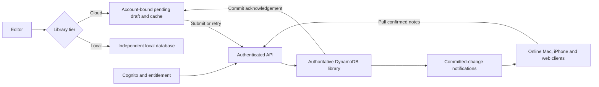

# Synkies product and technical specification

Version 0.8 | 29 October 2026 | Confirmed two-tier contract; implementation in progress

Brand update: 28 October 2026. Synkies replaces Peel and adopts Antigravity v2 Folded Horizon. Scope revision: 29 October 2026. Sandip replaces peer sync with independent Local storage and cloud-authoritative Cloud storage, and explicitly allows offline Cloud pending drafts with Saved only after server confirmation. Compatible repository/package/storage identifiers stay unchanged. Requirement IDs remain stable; retired IDs are not reassigned. See the [scope plan](features/two-tier-cloud-first.md) and [brand plan](features/synkies-brand.md).

This is the canonical behavior and implementation contract for Synkies. [PRFAQ.md](PRFAQ.md) defines the customer promise. Requirement IDs remain stable as this specification evolves. Implementation was authorized on 26 October. Current evidence and remaining gates live in [features/local-mac-app.md](features/local-mac-app.md); targets below remain acceptance targets until measured.

## Product scope

Build a personal note app with fast floating Mac notes, a searchable library and two whole-library tiers. Free Local storage is independent on each laptop, phone and browser installation, with no cross-device discovery or sync. Paid Cloud storage has one authoritative library in DynamoDB, pushes server-committed updates to online clients and provides complete authenticated web access. Local notes save directly on their device. Cloud clients may cache notes and durably retain offline pending drafts; upload on reconnect and show Saved only after matching server confirmation. Unuploaded drafts are not visible on other devices/web. Typing and cached search do not wait for network/authentication. The first user is Sandip; unrelated public accounts remain isolated.

Confirmed decisions: the app is Synkies; iPhone comes first and Android uses the web app. Mac is the only native desktop target.

### Delivery stages

| Stage | Deliverable                                              | Exit condition                                                                                                                    |
| ----- | -------------------------------------------------------- | --------------------------------------------------------------------------------------------------------------------------------- |
| M0    | Feasibility and performance experiments                  | Resolve the technical gates below before committing to the shell, sync layout, or model                                           |
| M1    | Local Mac dogfood app                                    | Capture, durable autosave, formatting, tags, lifecycle, word search, import and export pass                                       |
| M2    | Cloud-authoritative storage, live updates and web access | Server-confirmed saves, full web library, entitlement, live delivery, pending-draft recovery, reconnect and initial download pass |
| M3    | iPhone app                                               | Native persistence, authentication, lifecycle interruption, touch editing, and Mac/web parity pass                                |
| M4    | Search by meaning                                        | Local inference meets quality and performance gates on Mac, iPhone, and web                                                       |
| M5    | Public beta and launch readiness                         | All public requirements pass, 14 days of dogfooding complete, distribution and operating requirements met                         |

M4 experiments start in M0; the feature must not delay M1 capture. Local storage is a complete independent tier once its platform acceptance passes; it has no peer-sync requirement. Cloud is paid and operated in Sandip’s AWS account using DynamoDB. The green minus, Mac/iPhone/browser scope, search and release requirements remain. Google Drive is excluded. This explicitv0.8 decision supersedes v0.7’s remote peer promise rather than leaving it as a deferred requirement.

## Functional requirements

| ID    | Required behavior                                                                                                                                                                                                                                                                    | Stage                |
| ----- | ------------------------------------------------------------------------------------------------------------------------------------------------------------------------------------------------------------------------------------------------------------------------------------ | -------------------- |
| FR-01 | Create a focused blank note with one action. Mac supports a configurable global shortcut, menu bar action, and library action.                                                                                                                                                       | M1                   |
| FR-02 | Automatically persist Local notes durably on this device. Retain Cloud pending drafts durably, upload on reconnect and show Saved only after the server confirms the matching current edit. Closing preserves the latest Local note or pending Cloud draft.                          | M1 Local; M2 Cloud   |
| FR-03 | Offer two whole-library tiers: free independent Local storage and paid cloud-authoritative Cloud storage. Local installations have no awareness of other devices. Explicitly authorize complete-library Cloud upload; no per-note destination picker.                                | M1 Local; M2 tiers   |
| FR-04 | Store the authoritative entire Cloud library through an authenticated app-managed DynamoDB API. Keep account-bound caches/pending drafts, confirm server commits before Saved, push committed changes and expose the complete committed library on the web.                          | M2                   |
| FR-05 | Provide a Mac app, browser app including Android, and native iPhone app with the same note content and lifecycle behavior.                                                                                                                                                           | M1 to M3             |
| FR-06 | Search locally by words and tags; add an optional local search by meaning that returns source notes and excerpts.                                                                                                                                                                    | M1 words; M4 meaning |
| FR-07 | Edit, archive, unarchive, move to Trash, restore, and permanently delete notes.                                                                                                                                                                                                      | M1                   |
| FR-08 | Render available local/cached notes and accept typing without waiting for authentication, network, analytics or an AI model. Cloud offline typing remains Pending upload, never a confirmed Cloud save. Meet the performance budgets below.                                          | All                  |
| FR-09 | Parse inline tags beginning with `##` and expose tag filtering.                                                                                                                                                                                                                      | M1                   |
| FR-10 | Support only one Markdown heading level, bold, task checkboxes, bullets, and ordered lists, with lossless source storage.                                                                                                                                                            | M1                   |
| FR-11 | Use independent draggable top-level Mac notes outside Notes Library, with one top-left green minus Put away control. Commit a Local note or durably retain a pending Cloud draft before closing; Pending upload stays visible until server confirmation.                             | M1; M2 Cloud status  |
| FR-12 | Export portable Markdown plus metadata and import that format without duplicating matching note revisions.                                                                                                                                                                           | M1                   |
| FR-13 | Expose truthful tier-specific states and recover interrupted writes/transitions. Local uses Saved on this device; Cloud uses Pending upload/Saving to Cloud/Saved in Cloud only for the acknowledged current edit. Preserve concurrent offline Cloud drafts for explicit resolution. | M1 Local; M2 Cloud   |
| FR-14 | Keep unrelated users and Synkies accounts isolated. Keep note text, queries, tags, and tokens out of telemetry.                                                                                                                                                                      | All                  |
| FR-15 | Pin a note to the desktop by dragging it out of the Notes Library or choosing Pin to desktop from its right-click menu. Keep one note identity and unchanged storage.                                                                                                                | M1                   |
| FR-16 | Arrange open notes along the left, right, top, or bottom edge using configurable shortcuts and Window menu commands. Offer Undo last arrangement.                                                                                                                                    | M1                   |
| FR-17 | Retired in v0.8 by Sandip’s 29 October 2026 decision: peer pairing, remote device-to-device sync and transient relays are outside product scope. This ID is retained for historical evidence only.                                                                                   | Retired              |
| FR-18 | Require server-verified paid entitlement for Cloud APIs/live subscriptions. Local capture, search and export remain available without an account/subscription. Commercial terms remain a separate launch gate.                                                                       | M2                   |
| FR-19 | Retired in v0.8: peer latest-edit clocks/convergence and its seven-day peer recovery contract are outside product scope. Cloud conditional revisions/conflict preservation remain FR-13; this ID is not reassigned.                                                                  | Retired              |
| FR-20 | After an authoritative Cloud commit, push change notifications to active authorized online clients. Reconcile caches and pending drafts on reconnect; committed notes remain available through web access when the originating device is offline.                                    | M2                   |

The baseline excludes attachments, reminders, collaboration, live cursors, arbitrary rich text, generated AI answers, native Android, Windows, Linux, and automatic Google Keep import.

## Interaction contract

### Capture and windows

The proposed Mac shortcut is Control Option N. Detect registration failure and let the user choose another shortcut. The menu bar process stays resident after the last note closes; Quit is a separate action. Launch at login is an explicit preference. A shortcut works while the app is running; operating-system launch behavior is not assumed.

Launch at login reads the Mac's current login-item status and changes only after an explicit Settings action. Never register automatically on install/startup or silently re-enable a login item disabled in System Settings. Show pending approval separately from enabled, refresh on return to Synkies, and preserve the observed state on failure. Turning it off leaves the current app and notes running. Development executables and isolated test libraries cannot change login items. Verify registration, approval, disable and actual login/relaunch with the installed signed app before treating this behavior as accepted.

An action creates a new note ID in the selected tier and focuses an empty editor. Missing Cloud connectivity never silently switches tiers: retain a pending draft, show Pending upload/Offline and offer reconnection or an explicit whole-library transition. Local capture has no account or title prompt. Cloud authentication failures preserve cached notes and pending drafts without a Saved claim.

Floating notes are the primary Mac surface. On launch, restore the person's pinned desktop notes; opening Synkies does not require opening the library. New Note creates a note directly in its own floating window. Each note has at most one such window per Mac; opening an already visible note brings that window forward.

Each desktop note is an independent top-level macOS window, outside the Notes Library's bounds and view hierarchy. Closing, minimizing, or moving the library must not close, minimize, clip, or move its floating notes. They remain visible on the desktop while the library is closed. The desktop scene in the mockup is wallpaper and OS context, not a larger Synkies window containing the notes. Native window independence must be established in M0.

The note title bar has exactly one control: a green circle with a minus at the top left, called Put away. It performs the existing save-and-close action and keeps the note in the library. Do not add other minimize, maximize/fullscreen, pin, overflow, or always-on-top controls in that title bar. The remaining area is a drag handle. Keep on top, source view, and lifecycle/storage actions are available through right-click or app menus. The normal desktop note omits a persistent formatting toolbar and uses a quiet, noninteractive save/mode footer; Markdown editing remains available in the body. Save failures may expose recovery actions in the note body.

Open Notes Library shows a separate, resizable full library window. Provide the action in the menu bar, the Window menu, and the desktop mockup's library control. Command Shift L is the proposed app-level library shortcut. The library shows all notes in the selected collection, including notes already pinned to the desktop, with a visible desktop indicator. Its window can close while floating notes remain open.

Drag a floating note by its title bar to move it freely. Selecting text, ticking a checkbox, or using a toolbar never moves the window. Persist bounds, display identity, open/pinned state, and always-on-top preference locally. Clamp restored windows to the usable display area after resolution or monitor changes. Desktop geometry and pinning do not sync to other devices.

The desktop editor has the body, a compact saving-mode indicator, and context/app menus for archive, delete, export, source view, and window options. The library has Notes, Archive, Trash, tag filters, search, and New Note. Its default sort is most recently edited. Display titles derive from the first nonempty text line, capped at 80 characters; an empty note displays Untitled. No separate title field is required.

Closing an untouched empty draft removes that draft. Clicking the sole top-left green Put away button on a note containing text, a tag, or a checklist flushes the latest local changes and closes only that note window after a successful commit. It leaves the note in the library and does not force the library to open. Escape dismisses menus and search overlays; it does not close or discard a note. Command W performs the same save-and-close action. Command Q flushes all pending local writes before quitting.

### Pinning from the library

Drag an active note card outside the library window and release it over the desktop to pin it at that location. Show a drag preview and the prospective desktop placement. Keep the source card in the library: this is another view of the same note, not a copy or a storage move. Escape or dropping back inside the library cancels the operation. Native drop handling outside the library is an M0 feasibility gate.

The library card's right-click menu includes Pin to desktop. If it is already open, offer Bring to front and Remove from desktop. A successful second pin focuses/repositions the existing note rather than creating a duplicate. Archived or trashed notes must be restored/unarchived before pinning. Right-click remains an alternative to dragging for people using a keyboard or assistive technology.

Pinning means keeping a note open on the desktop and restoring its placement next launch. It remains movable. Keep on top independently controls whether it stays above other application windows. Removing a note from the desktop closes its window after saving; it remains in the library. Explicitly closing a pinned note removes it from the current desktop set, so it does not immediately reopen on relaunch. Quit preserves the current desktop set for the next launch.

### Arranging desktop notes

Provide these proposed, configurable global shortcuts while Synkies is resident:

| Action         | Shortcut                           |
| -------------- | ---------------------------------- |
| Arrange left   | Control Option Command Left arrow  |
| Arrange right  | Control Option Command Right arrow |
| Arrange top    | Control Option Command Up arrow    |
| Arrange bottom | Control Option Command Down arrow  |

Expose the same commands under Window, with shortcut labels. Settings provides device-local Capture and four-edge bindings, Disable, Restore defaults and Retry activation. Validate duplicate combinations and reserved editing/app commands before changing registration. A non-function key needs at least two modifiers including Control or Command; supported physical keys are letters, digits, arrows and F1 to F20. Labels and behavior on non-US keyboard layouts require native verification.

Save a changed preference only after its OS registrations succeed, then publish the new action routing. On registration or persistence failure keep the previous preference, attempt rollback and show any unavailable or uncertain registrations. Menu actions remain usable even when a global shortcut fails. Command N stays the app-level New note action. These preferences stay on the current device. The browser mockup handles its proposed keys only while the preview has focus; native acceptance requires actual global capture and arrangement checks.

The target is the display containing the focused Synkies window, otherwise the pointer's display. Arrange all open notes on that display; preserve notes on other displays and the library's bounds. Left/right forms a vertical arrangement against that edge; top/bottom forms a horizontal arrangement. Respect the menu bar, Dock, usable display bounds, and readable minimum note sizes. Keep a stable note order. A manual drag after arrangement moves only that note.

When full content cannot fit, resize within minimum bounds and then cascade with accessible title bars. Further overlap must retain access through the Window menu and library rather than placing windows off-screen. The final native layout policy is validated with one, three, ten, and thirty notes. Arrange changes geometry only, never note content, archive state, pin identity, or library mode.

Save the preceding geometry as Undo last arrangement and expose it in Window. Restoring that layout must not undo text edits. Persist the resulting layout locally after the command completes.

### Saving and recovery

Submit editor transactions immediately to local persistence, coalescing at most 50 ms. In Local storage, a committed local transaction permits Saved on this device. In Cloud storage, atomically retain the pending draft/operation for crash recovery, then submit to the authoritative service. This local retention is not a Cloud save. Show Pending upload/Saving to Cloud until the server confirms the matching current edit; a receipt for an older draft never marks newer typing Saved.

Native close and quit flush the latest Local note or pending Cloud draft and await durable retention. After 500 ms, show Saving on this device or Retaining draft as appropriate. Retention failure keeps the editor open with Retry and Copy text. Cloud Put away does not require a network round trip after successful draft retention, but its library entry remains Pending upload until server confirmation. Never report a successful Cloud save merely because the window closed.

Browser writes happen during editing. Page unload is not a durability mechanism, and uncommitted input has no recovery guarantee. Restore every acknowledged Local save and every durably retained pending Cloud draft after termination. During iPhone backgrounding, flush promptly and recover committed drafts on resume. Reopen server-confirmed Cloud notes from the server even if the original device is gone.

Local states are Saving, Saved on this device and Could not save. Cloud states are Pending upload, Saving to Cloud and Saved in Cloud, with Offline, Sign in again, Conflict or Sync paused reasons when applicable. Saved in Cloud requires the current edit’s authoritative acknowledgement; a locally retained draft may remain Pending upload indefinitely while offline. Live/Connecting describes the notification channel separately and does not acknowledge an edit.

### Storage tiers and transitions

The tier belongs to the whole library, not each note. A fresh installation starts in free Local storage without a Cloud account. Every Local installation is independent: no device list, discovery, pairing, signaling, relay, peer sync or cross-device awareness. Explicit portable export/import is allowed and does not establish a live relationship.

Cloud is the authoritative shared library. Upload a Local library only after an explicit whole-library preview/authorization; sign-in alone uploads nothing. Retain at least one complete recoverable copy throughout upgrade. A pending source draft is not confirmed or shared until its server mutation succeeds. Download the complete confirmed Cloud library and reconcile/explain pending drafts before downgrading this installation to independent Local storage. Other devices and Cloud data are not silently deleted or switched. Billing cancellation, Cloud-data removal and account deletion are separate choices with published retention.

Persist transition metadata with source/destination identities, account, generation, stages, complete snapshots and acknowledgements so interruption cannot lose the only copy. Import follows the selected tier and discloses upload consequences. Export is always available. Sign-out/account switching separates caches, pending drafts and indexes and offers draft copy/export recovery; no draft crosses accounts.

### Cloud authority and delivery

The flow is editor/pending draft, authenticated server mutation, authoritative DynamoDB commit/acknowledgement, then push/reconciliation to online Mac/iPhone/browser clients. The complete committed library is accessible on the web independently of any source device. There is no device-to-device path or server dependency for Local storage notes.

A Cloud client may retain cached confirmed notes and offline pending drafts. On reconnect, authenticate, reconcile server state and conditionally submit the original pending operation. Failed auth, quota or conflict preserves the draft and truthful status. Unuploaded drafts remain only on their source device; no other client/web can display them yet. Once Cloud confirms an edit, the source may go offline and other clients can still fetch it. Push is a hint to pull confirmed state, never an alternative authority or proof that every device has received the edit.

Cloud revisions and explicit conflict preservation below apply to concurrent offline drafts. Device clocks never silently overwrite a remote edit. Permanent deletion markers reject stale resurrection. Retained peer prototype code/experiments are historical and outside v0.8; no peer clock, pairing or relay acceptance gate remains.

### Markdown and tags

Store the original Markdown body as UTF-8 text. Use a shared parser for native and browser clients, configured for this subset:

| Element       | Syntax                        | Rule                                                                           |
| ------------- | ----------------------------- | ------------------------------------------------------------------------------ |
| Heading       | `# Heading`                   | Only ATX H1, with a space after `#`; multiple headings may use this same level |
| Bold          | `**important**`               | Asterisks only for the first release                                           |
| Checkbox      | `- [ ] Task` and `- [x] Done` | A tap or click updates source text and saves; uppercase X also accepted        |
| Bullet        | `- Item`                      | One list depth; ordinary Markdown continuation lines remain part of their item |
| Numbered list | `1. Item`                     | One list depth; preserve source numbers and render ordered list semantics      |
| Tag           | `##work`                      | App extension parsed as described below                                        |

Unsupported syntax remains literal editable text. Do not render raw HTML, images, tables, code blocks, nested list levels, or additional heading levels. Pasting Markdown never deletes unsupported characters. A source-editing mode must remain available; preview and toolbar actions must preserve supported content. URLs are plain text in v1. Block unsupported browser navigation or script execution from note content.

A tag starts at the beginning of a line or after whitespace. Its label contains 1 to 64 Unicode characters; the first character must be a letter or number and later characters may be letters, numbers, combining marks, underscores, or hyphens. Combining marks preserve canonically equivalent decomposed spellings. Punctuation terminates it. Normalize to NFC and Unicode case folding for matching, retain the first display spelling, and deduplicate within a note. Backslash escaping makes `\##work` literal. `## work`, `C##`, and `###work` are not tags. Tag recognition uses the shared parsed text so platform behavior stays identical.

Tags are derived from the body, not an independently editable second source. Removing the last occurrence removes that note's tag. A tag chip filters the library; multiple selected tags use AND. Global tag rename is deferred. Tag suggestions come only from the current collection.

Example supported note:

```text
# Launch ideas
Try **a shorter signup**. ##work ##growth
- [ ] Draft two variations
- [x] Capture the current flow
- Keep the first screen small
1. Test with five people
2. Review the results
```

### Archive and deletion

Archive preserves text and tags, removes a note from Notes, and closes its floating window after a local save. Word and meaning searches include archived notes by default, with an Archived label and an Active only filter. Unarchive returns the note to Notes.

Delete moves a note to Trash. Trash is excluded from ordinary search and the semantic index. Restore is available for 30 days from deletion. After that, purge retained content on the next successful maintenance pass. Delete permanently accelerates the purge after confirmation. Collection metadata retains a small deletion marker without note text to reject stale edits from devices that have been offline longer than 30 days.

Local lifecycle changes affect only this installation. In Cloud, concurrent delete/edit hides the note from ordinary views but preserves the edit as a recoverable conflict until the deletion deadline. After permanent purge, stale clients must not re-upload that note ID; explicit recovery creates a new ID. Provider backups and user exports have separate retention; do not claim immediate physical erasure.

## Storage design and operating cost

### Confirmed storage choices

Local storage commits its independent library directly to SQLite/native or IndexedDB/browser. Cloud uses DynamoDB as its single authoritative library; clients retain account-bound caches and pending drafts for responsive editing/recovery, but only a matching server commit is a Cloud save. Search indexes and embeddings remain on devices. Google Drive and peer connectivity services are excluded.

The operator pays for Cloud resources and shared app-shell hosting. Local storage requires no peer signaling/relay service or note-hosting account. Use one initial AWS region, us-east-1, with separate development/production resources and Standard/on-demand DynamoDB. The dated database scenario below is a component estimate, not a deployment allowance or complete price.

### Cloud hosting and live-update cost

Measure authenticated requests, confirmed mutations, active connection-minutes, push/fan-out, reconnect/change pulls, billing events, transaction amplification, account storage, backups, hosting and transfer. Polling is a degraded reconnect fallback, not the primary live mechanism. No TURN fleet, pairing directory or free relay bandwidth budget is required. Verify current rates and measured traffic before deployment; do not invent a subscription price or revive historical allowances.

### Illustrative DynamoDB cost model

Rates checked on 26 October 2026 in us-east-1: USD 0.625 per million write request units, USD 0.125 per million read request units, and a marginal storage rate of USD 0.25 per GB-month. The regional price list was published on 11 September 2026. The model below intentionally applies no free allowance or credits. [AWS regional price list](https://pricing.us-east-1.amazonaws.com/offers/v1.0/aws/AmazonDynamoDB/current/us-east-1/index.json), [DynamoDB pricing](https://aws.amazon.com/dynamodb/pricing/).

Assume 1,000 users, 20 GB of current content, 20 cloud mutations per user per day, and 30 days. Budget 12 write units per mutation for a transaction containing a note up to 3 KiB plus three metadata items up to 1 KiB each. Transactional writes use twice the ordinary write units. Allow 60 strong-read units per user per day for content retrieval. Separately model two devices per user, each actively polling every 30 seconds for two hours per day. [Request unit definitions](https://docs.aws.amazon.com/amazondynamodb/latest/developerguide/Constraints.html).

| Component                                | Calculation                      | Monthly USD |
| ---------------------------------------- | -------------------------------- | ----------: |
| Current content at marginal storage rate | 20 x 0.25                        |        5.00 |
| Transactional writes                     | 600,000 x 12 / 1,000,000 x 0.625 |        4.50 |
| Content reads                            | 1,800,000 / 1,000,000 x 0.125    |        0.23 |
| Polling metadata reads                   | 14,400,000 / 1,000,000 x 0.125   |        1.80 |
| Illustrative database subtotal           | Unrounded sum, rounded once      |       11.53 |

This is a database scenario, not a complete product bill. Add storage for revisions/metadata, extra query pages, retries and conflict reads, Cognito, API Gateway, Lambda, email delivery, CloudFront, transfer, backup, logs, taxes, and native distribution. Polling also generates API calls, so public scale requires measuring API cost as well as database cost. Coalesce cloud uploads, use push for live delivery, back off fallback polling, and set budgets before inviting public users. Reprice using measured dogfood traffic before launch.

## Technical architecture

### Proposed stack and boundaries

Use a pnpm TypeScript workspace. Share the domain model, Markdown and tag parsing, sync state machine, and React editor/library UI. Build a static Vite web app; server rendering is unnecessary for private note content. Use Tauri 2 for the Mac shell and, subject to M0 validation, the iPhone shell, with Rust/native bridges for persistence, windows, authentication callbacks, and inference where needed. Tauri supports web frontends with native desktop and mobile integrations. [Tauri architecture](https://v2.tauri.app/start/).

Use SQLite transactions in native clients and IndexedDB transactions in the browser. A repository interface hides the storage difference. Use a shared JavaScript search engine in a worker for lexical ranking so tokenization and ranking stay consistent across platforms. Persist an index snapshot with a schema version and rebuild it from notes if stale. The search index is derived data, never the only copy of a note.

The initial Mac/browser editor uses CodeMirror 6 with source-preserving decorations for the explicit supported-feature allowlist. Markdown source remains available. Dependency versions are exact in package.json and lockfiles. M0 still needs native VoiceOver and iPhone composition evidence before this editor is accepted for all clients. Do not build a general rich-text system.



Source layout (later packages are created as their milestones start):

```text
apps/web/                 Static browser app and offline application shell
apps/native/              Tauri Mac and iPhone shells
packages/core/            Note commands, types, tags, Markdown, validation
packages/storage/         Native and browser repository contracts
packages/sync/            Mode transitions, outbox, cloud conflicts and API client
packages/search/          Shared lexical ranking and semantic workers
packages/ui/              Editor, library, status and accessibility
infra/                    AWS hosting defined as code
docs/features/            Requirement-linked implementation plans
```

If Tauri fails capture or iPhone editing requirements in M0, prefer a thin SwiftUI native shell while retaining portable contracts and the web app. Record that architecture change in this SPEC before implementation. The native wrapper is a measured decision, not an assumption that a framework alone guarantees speed.

### Data contract

Generate note and operation IDs on the device. UTC timestamps support display, retention, and sorting; they never decide which concurrent edit wins. The server derives the owner from a verified Cognito subject, not an owner ID supplied in the request body.

```typescript
type Collection = {
  id: string;
  kind: "on-device" | "peel-cloud";
  modeGeneration: number;
  ownerSubject?: string;
  schemaVersion: 1;
};

type NoteSnapshot = {
  schemaVersion: 1;
  collectionId: string;
  noteId: string;
  bodyMarkdown: string;
  state: "active" | "archived" | "trashed";
  createdAt: string;
  updatedAt: string;
  deletedAt: string | null;
  purgeAfter: string | null;
  serverRevision: number | null;
  origin?: { collectionId: string; noteId: string; moveId: string };
};

type CloudMutationSnapshot = Omit<NoteSnapshot, "serverRevision">;

type PendingMutation = {
  version: 1;
  opId: string;
  noteId: string;
  baseRevision: number; // zero means a new cloud note
  kind: "upsert" | "purge";
  snapshot: CloudMutationSnapshot | null;
  contentHash: string;
};

type CloudMutationRequest = {
  version: 1;
  collectionId: string;
  modeGeneration: number;
  mutation: PendingMutation;
};
```

Tags/display titles derive from body text. Geometry, save status, model files, search vectors and local revisions stay device-local. Cloud requests omit serverRevision; baseRevision is the conditional write precondition. Clients retain the latest confirmed Cloud base, pending drafts/operations, conflicts, transitions, cursors and deletion markers. Stored identifiers such as on-device/peel-cloud remain compatible internal names for Local/Cloud. Legacy peer fields or prototype packages may remain inactive until separately reviewed cleanup/migration; they do not create a device relationship. Never rewrite an actual library merely to rename the tier.

The following protocol applies only to Cloud; Local storage has no sync engine. Coalesce typing into the latest pending snapshot while preserving its acknowledged Cloud base. An in-flight mutation is immutable; later typing becomes a new pending draft. On matching acknowledgement, atomically rebase that subsequent draft without dropping text and retain Pending upload until it too is confirmed. A retry preserves the same opId/content hash.

The [isolated Cloud client reducer](features/cloud-client-conflicts.md) is a prerequisite for this local transition contract, not an app or server implementation. Its [local durability adapter](features/cloud-local-durability.md) commits the note projection and pending operation in one generation-checked state row, with SQLite/IndexedDB failure and restart evidence. The production repository must compare the source generation when committing an asynchronously prepared mutation, so a newer local save cannot be replaced by stale hash work. A queued permanent purge cannot be coalesced back into an upsert under the same note ID; recover text as a new note.

The server assigns monotonically increasing per-note revisions. Apply an upsert only when baseRevision equals the current revision; zero is accepted only for a never-created ID with no deletion marker. A mismatch returns 409 with the current server version. Keep both versions locally, mark Conflict rather than Saved in Cloud, and require an explicit resolution. Combining versions produces a new mutation based on the latest remote revision; another 409 preserves the merged draft and asks the person to review again. Do not overwrite a remote edit using device time.

Public v1 does not automatically persist an unresolved local conflict branch to the cloud. Its status must make clear that the draft is only on the device; Copy and Export are available before sign-out or cache removal. A lost local-only draft is not an acknowledged cloud save.

Reject unsupported schema versions without rewriting data. Back up native data before a migration and make migrations restartable. The cloud API supports versioned contracts and returns an explicit upgrade-required error for unsupported clients.

### DynamoDB and sync contract

Clients call an authenticated HTTPS API implemented with API Gateway and Lambda. They do not access the DynamoDB table directly. Use DynamoDB key queries for per-user notes and changes; do not scan the complete table for a user's library or for search.

The isolated [Lambda payload-v2 adapter](features/cloud-lambda-event.md) bounds event/response conversion, pins the configured origin and preserves raw query/cookie ambiguity for the trusted Fetch service. It supplies no authentication policy, listener or infrastructure by itself. Verified service composition, real gateway/proxy configuration and hosted acceptance remain separate gates.

The [configured Lambda sync service](features/cloud-lambda-http.md) composes that adapter with explicit DynamoDB mutation/pull stores and either pinned Cognito access-token verification or durable browser-session/CSRF verification. Mixed credential modes and event-supplied identities cannot select an owner. Synthetic RSA and local-engine tests exercise the actual routes; managed login, deployment policy, live delivery and app integration remain open. The entry point exposes data routes only, with no session-issuance shortcut.

The [composed foundation evidence](features/cloud-foundations-evidence.md) connects those routes to durable Node SQLite clients: interrupted download/cursor commits, lost acknowledgements, later drafts, explicit conflict resolution, stale purge rejection and private authorization/storage failures. These synthetic local-engine cases are M2.1 exit evidence, with production authentication-context dispatch, managed hosting, live delivery and app/platform acceptance still required.

Initial single-table layout:

| Partition key    | Sort key                        | Purpose                                                         |
| ---------------- | ------------------------------- | --------------------------------------------------------------- |
| `USER#<subject>` | `META`                          | Per-user sync sequence and current collection generation        |
| Same             | `NOTE#<noteId>`                 | Current cloud snapshot and server revision                      |
| Same             | `CHANGE#<zero-padded-sequence>` | Compact note ID, revision, change type, and retention timestamp |
| Same             | `OP#<opId>`                     | Idempotency outcome and content hash                            |
| Same             | `TOMB#<noteId>`                 | Body-free permanent deletion marker                             |

A mutation transaction conditionally updates the note, advances META from an expected sequence to the next sequence, appends the change record, and writes its idempotency result. The request collection and mode generation must match current server metadata, including for a purge without a snapshot. Current account/entitlement state participates in the transaction condition. Retry sequence contention internally; return a note-revision conflict to the client. Check note conditions in the update itself rather than using a separate condition action on the same item. If the opId exists, compare the hash and return its prior outcome; a different payload or scope for the same ID is rejected.

Keep idempotency receipts body-free. A retry response includes the original applied/conflict classification and original revision/sequence, alongside the latest current note or permanent purge head. The current head can be newer than the receipt. Clients reconcile that head and never interpret a replayed acknowledgement as proof that no later edit or deletion exists. A conflict retry returns the current remote version without retaining its old body in the operation record. [Server mutation implementation plan](features/cloud-server-mutations.md).

The isolated service and HTTP/client adapters have local SQLite and synthetic loopback evidence. They do not enable application Cloud mode or establish Cognito/DynamoDB acceptance. If a success receipt matches the current in-flight operation but its current head is newer, retire that known-accepted operation atomically. Adopt the remote head when no later local action exists; otherwise keep the latest local action as a conflict against that head. Do not fabricate an intermediate historical snapshot from the body-free receipt. [Per-note reconciliation plan](features/cloud-head-reconciliation.md). The [paginated pull implementation](features/cloud-paginated-pull.md) adds isolated bootstrap/change and atomic local cursor evidence; production account, store, push and app integration remain open. Single-note HTTP reads carry the expected collection and mode generation in `X-Synkies-Collection` and `X-Synkies-Mode-Generation`; the owner always comes from server authentication.

The [DynamoDB mutation adapter](features/cloud-dynamodb-mutations.md) implements the same server read/write contract using transactional reads and conditional writes, including atomic content removal on purge. Its DynamoDB Local suite is isolated implementation evidence; managed-service IAM/cost/backup behavior, hosting and app activation remain open. It does not provision a table or enable Cloud in the app.

Retain idempotency outcomes for 90 days. After that window, conditional note revisions still prevent replaying an already successful write; a stale client pulls and rebases into a new operation rather than assuming an old acknowledgement can be recovered. Keep permanent deletion markers for the lifetime of the account to reject stale creation of purged IDs. Account deletion removes that account's content and permanently invalidates its old identity.

DynamoDB limits an item to 400 KiB including attributes. The body limit is 256 KiB in UTF-8, leaving room for metadata. Validate both body and serialized item size before writing; do not place all notes, all versions, or the semantic index in one item. Transactions are limited to 100 distinct items and 4 MiB; the design's ordinary mutation is a bounded small transaction. [DynamoDB constraints](https://docs.aws.amazon.com/amazondynamodb/latest/developerguide/Constraints.html).

API surface:

| Route                         | Behavior                                                                                                           |
| ----------------------------- | ------------------------------------------------------------------------------------------------------------------ |
| `GET /v1/library-context`     | Discover only the authenticated caller's active paid library scope; no client-selected owner or library, and no access grant for later requests. See [implementation plan](features/cloud-library-context.md). |
| `POST /v1/sync/bootstrap`     | Capture the current server sequence and start a paginated current-state download                                   |
| `GET /v1/notes?pageToken=...` | Return current snapshots and tombstones for the authenticated account only                                         |
| `GET /v1/sync?after=...`      | Validate a completed checkpoint and start a change round with a stable upper sequence                              |
| `GET /v1/sync?pageToken=...`  | Continue that round, returning current heads for ordered changes and an opaque next cursor or completed checkpoint |
| `GET /v1/notes/<id>`          | Return the latest snapshot/revision or a purge marker                                                              |
| `POST /v1/mutations`          | Apply one idempotent conditional mutation; return acknowledgement or 409                                           |
| `POST /v1/account/export`     | Authorize export of the caller's collection; stream/page results without a public URL                              |
| `DELETE /v1/account`          | Start authenticated account deletion with confirmation and a measurable completion status                          |

Page tokens are signed, owner-bound, and validated. Bind each to its purpose, account/library/mode generation, round, phase, bounds and progress. The isolated implementation uses an injected nonextractable HMAC-SHA256 key; production key storage, rollout and rotation still need hosting acceptance. Provisional limits are 32 records, a 512 KiB aggregate head budget and a 640 KiB serialized page limit. Continuation tokens expire after 15 minutes; completed checkpoints after 90 days. A byte-limited page never advances past an unreturned head/event. Continue DynamoDB queries until LastEvaluatedKey is absent; a short or empty page does not prove completion. The [DynamoDB pull adapter](features/cloud-dynamodb-pull.md) now supplies base-table key queries and continuation handling to the existing signed service, with isolated engine-boundary and durable-client evidence. Hosted consistency/cost and application activation remain separate gates. [DynamoDB query pagination](https://docs.aws.amazon.com/amazondynamodb/latest/developerguide/Query.Pagination.html).

Bootstrap captures sequence S and bounded note/tombstone key ranges before the current-state scan, then replays changes after S through sequence U captured at scan completion. Later change rounds capture their own stable U. This covers notes added, updated, or deleted while pages download without requiring an unbounded scan under ongoing writes. Each change names a current note/revision; fetch the current snapshot and apply monotonically by server revision. A newer snapshot can supersede several older events without replaying old content.

Process each received page and its cursor in one local transaction. Retain server changes for 90 days. A cursor outside the supported window returns 410 Snapshot required even if background TTL cleanup has not removed the rows. Resnapshot while preserving local drafts, then replay/rebase or show conflicts. The server must never give a client an advanced cursor without applying the corresponding state.

The isolated local Cloud adapters use schema/state version 2, upgrading recognized version-1 drafts without changing their text or generation. Unknown schemas refuse modification, and a failed upgrade leaves version 1 intact. A page commits all changed note states and pull progress together using note/progress generations. Clean notes adopt current heads; unsent work becomes a conflict. While an immutable operation is in flight, retain the latest observed head durably, leave its retry unchanged, and reconcile the observation when its receipt/conflict settles. A collection checkpoint does not acknowledge an outstanding note write. Restored-server absence handling remains a production gate: bootstrap cannot silently delete a local-only note or unresolved draft merely because a scan omits it.

For paid Cloud, submit the newest committed snapshot within 250 ms while connected, coalescing edits without starving continuous typing. Flush local state on close immediately; cloud acknowledgement never blocks Put away. After acknowledgement, push a body-free change notification with account/library generation, sequence and note ID to authenticated live connections. Recipients pull/apply it transactionally. Use API Gateway WebSocket with short-lived scoped connection tickets and Lambda fan-out, or a measured equivalent. Never put access tokens in logged URLs. Authorize subscriptions server-side, revoke on sign-out/entitlement changes, and reject cross-account fan-out. [API Gateway WebSocket APIs](https://docs.aws.amazon.com/apigateway/latest/developerguide/apigateway-websocket-api.html).

The isolated [change-hint contract](features/cloud-change-hints.md) uses only version1, library-changed kind, ownerSubject, collectionId, modeGeneration, a positive committed account sequence and noteId. Receivers validate against their captured scope; derivation requires actual committed change evidence and a trusted server scope. The codec supplies no authentication/paid/subscription grant, acknowledgement, cursor commit or live transport.

The isolated [hint catch-up owner](features/cloud-hint-catchup.md) can accept a scoped hint for one bounded durable download pass. Only completed validated progress deduplicates a hint; later targets remain pending, and a completed older partial round requests a later fresh pass before treating a target as unverified. The owner neither loops automatically nor treats a hint or collection cursor as a note acknowledgement. This remains development integration, without a live listener or enabled Cloud.

Live push is a delivery hint, not a second system of record. Reconnect from the durable cursor, fill gaps, deduplicate notifications, and bootstrap when history has expired. Pull on foreground, reconnect, explicit refresh and before queued writes. Poll with jitter every 30 seconds only as a degraded fallback; back off idle clients. Elect one browser-tab leader. Show Live, Connecting, Waiting to sync, Offline or Sync paused truthfully. Suspended devices catch up when active rather than receiving an impossible render guarantee.

Retry temporary API failures with exponential backoff, jitter, Retry-After and a five-minute ceiling. A 401 refreshes auth or shows Sign in again; 429/503 exposes retry; validation/upgrade errors pause upload. Preserve cached confirmed notes and pending drafts. Show Saved in Cloud only after API acknowledgement of the current edit; use Pending upload/Conflict/reasoned pause otherwise. A local draft commit never changes that rule.

The server assigns cloud deletion/retention timestamps from server time; client-supplied clock values cannot shorten or extend cloud retention. Trash becomes non-restorable when purgeAfter passes, regardless of physical cleanup timing. Use a scheduled cleanup path to replace expired content with body-free tombstones and remove retained note content; API reads enforce the deadline immediately. TTL handles expendable change/idempotency cleanup, not correctness or exact deletion deadlines, because AWS deletes expired items asynchronously. Encode those TTL values by rounding the logical millisecond expiry up to epoch seconds, so physical cleanup cannot precede the promised retention deadline. [Boundary regression](features/cloud-ttl-rounding.md). [DynamoDB TTL](https://docs.aws.amazon.com/amazondynamodb/latest/developerguide/TTL.html).

Enable point-in-time recovery for hosted beta, initially a documented 7-day recovery window, and test a restore to an isolated table. Backups may retain deleted text until their recovery window expires. Reconcile deletion requests before a restored table can serve traffic, so a restore does not revive removed accounts or notes. DynamoDB supports a configurable recovery period from 1 to 35 days. [Point-in-time recovery](https://docs.aws.amazon.com/amazondynamodb/latest/developerguide/Point-in-time-recovery.html).

### Authentication and security

Local storage needs no Cloud account, device registry or connectivity service. Its libraries do not exchange note content or metadata. Explicit tier activation is the only route to uploading a Local library.

Cloud uses a Synkies Cognito identity and server-verified entitlement. Users do not supply their own AWS credentials. Authentication, owner/account/library/mode generations and permissions are enforced on the server; no client-paid flag or note-supplied owner grants access. Pending drafts and caches remain bound to their original account. Retired peer authentication/trust/session/inventory experiments are historical evidence, not requirements or Cloud authorization.

Use Cognito managed login with authorization code flow, PKCE S256, state, and pre-registered platform callbacks. Native clients open the system browser and store refresh credentials in the OS keychain. Public clients have no embedded client secret. [Cognito authorization](https://docs.aws.amazon.com/cognito/latest/developerguide/authorization-endpoint.html).

The isolated Node [PKCE handshake](features/cloud-pkce-handshake.md) pins a public client/provider/callback, bounds one private attempt per initiator and rejects ambiguous, expired or replayed callbacks before an injected exchange. Cancellation or replacement withholds late results. Real exchange/token validation, browser-bound shared attempt persistence, native implementation/system-browser callbacks and keychain storage remain integration gates; the helper alone does not authenticate a user or enable app login.

For web, use a same-origin backend session: an HttpOnly, Secure, SameSite cookie and server-held token material. The backend exchanges authorization codes and refreshes tokens; JavaScript never receives refresh tokens. Protect mutations with origin validation and an anti-CSRF token. Native API calls use access tokens validated by API Gateway against the Cognito issuer, audience, and required scopes; the web backend forwards its verified session identity through an equivalent trusted path. Owner IDs always derive from authenticated claims. [API Gateway JWT authorization](https://docs.aws.amazon.com/apigateway/latest/developerguide/http-api-jwt-authorizer.html).

The isolated [access-token boundary](features/cloud-access-token-auth.md) uses pinned `aws-jwt-verify` on the server to validate an explicit Cognito pool, allowed clients, access-token type, signature, lifetime and required sync scope before resolving a subject. It plugs into the existing HTTP handler; valid authentication still passes through current account/entitlement checks. Synthetic signed-token tests do not establish real Cognito login, managed API Gateway configuration, web-session/CSRF controls or hosted account acceptance.

The [browser session boundary](features/cloud-web-sessions.md) issues opaque host-only Secure/HttpOnly cookies after a trusted authentication resolver succeeds, stores credential digests through an explicit persistence interface, and checks exact origin plus a session-bound anti-CSRF header on unsafe API requests. Synthetic session tests exercise rotation/logout, expiry, account isolation and failure before note/body access. The [DynamoDB session adapter](features/cloud-web-session-dynamodb.md) supplies atomic digest-only inserts, strongly consistent lookup and conditional durable revocation, with body-free owner references for future account cleanup. Disposable local-engine tests cover reopen, collisions, concurrent revocation, malformed records and failure before cookie issuance. Managed-login/code exchange/refresh, provider logout, account-wide invalidation/erasure, route/proxy configuration, managed-service acceptance and real browser integration remain open; the app has no Cloud login enabled from these modules alone.

Captured browser JSON transports send their original session token on every request. The boundary validates an explicitly supplied anti-CSRF header even on safe reads, preventing an older sender from silently following a later account's cookie. Plain safe requests without that header retain their existing behavior; unsafe Origin/token requirements and all cookie, expiry, revocation and paid-policy checks remain mandatory. See [safe-read session binding](features/cloud-safe-read-session-binding.md).

Expired authentication does not prevent local editing. A cloud note's pending edits remain bound to its account until reauthentication or explicit export. Sign-out and account switching never upload a draft under another identity or silently upload an independent Local library. Rate-limit sign-up, sign-in, password reset, and sync APIs. Set per-account note/storage and request quotas before public launch; finalized limits and any paid tiers must be reflected in UI and pricing.

Use HTTPS, DynamoDB encryption at rest, a restrictive content security policy, text-safe rendering, and narrow native IPC permissions. Never log bodies, titles, tags, queries, or credential material. The service can process cloud note plaintext; the design is not end to end encrypted. Local databases, caches, exports, and semantic vectors contain private content protected by their OS/browser context. Delete derived vectors when source content is purged.

### Paid Cloud entitlement

Cloud activation, API reads/writes, live subscriptions and background jobs require a server-verified entitlement bound to the Cognito subject and library. Billing webhooks must have verified signatures, replay/idempotency protection, and a durable entitlement state. Native/web UI reflects the server state, including pending verification, active, payment failed, cancel-at-period-end and expired. Do not unlock Cloud merely from a checkout return URL. Independent Local capture, search and export must remain available without payment.

Pricing, provider, trials, grace period and retained-cloud-data deadlines remain launch gates. Display exact price/cadence and terms before a real purchase; mockups say Paid and explicitly show that pricing is not set. No live charge or invented entitlement is authorized by a mockup button. Cancellation stops renewal according to published terms and is distinct from data deletion. On lapse, keep local editing, export and a safe downgrade available; show paused Cloud and retention status. Test webhook duplicates, ordering, revoked purchases and account switches before paid deployment.

### Local search

Word search is the default mode. It searches the full body, derived title, and normalized tags in the selected collection. Query terms use case folding and AND semantics; a final token supports prefix matching, and double-quoted phrases require contiguous words. Rank title and tag matches above body matches, then break ties by updatedAt and noteId. Use a shared tokenizer and fixtures across all clients. The initial full-text quality target is English; preserve Unicode text and provide normalized literal matching when tokenization is unsupported.

Search includes Archive, excludes Trash, and respects selected tags and Active only. Updates become searchable within one second of a local commit. Cached data can be searched offline. On a new device, show Downloading notes until the initial corpus is available; never present partial results as the full collection.

Search by meaning is a separate mode with a one-time model download choice. Run a versioned small embedding model locally in a worker or native inference bridge. Choose and pin the model, quantization, tokenizer, download hash, and license in M0. Package or cache verified artifacts; no hosted LLM or vector database is required. No note or query leaves the device for inference.

The isolated [local meaning experiment](features/local-meaning-experiment.md) pins one q8 all-MiniLM candidate and records synthetic retrieval, byte counts, worker timing and scoped browser RSS. The [verified model cache experiment](features/meaning-model-cache.md) also proves fresh-worker offline inference after reopening a dedicated Chrome profile, with cancellation/integrity/atomic-update controls. These do not select the public model or pass AC-06/14. Production offline shell/CSP integration, quota recovery, native/iPhone inference, memory budgets and held-out dogfood quality remain gates before app activation.

Chunk long notes without losing note identity, index active and archived content incrementally, and combine semantic and lexical ranks. Return distinct notes with matched excerpts. Resolve duplicates, tags, archive filters, and deletion filters before showing results. Do not promise date interpretation or generated summaries in v1; search by meaning is retrieval rather than a conversational agent.

Bind every derived vector index to a fingerprint of model/tokenizer artifacts, quantization, pooling/normalization, chunk/batch policy and runtime/backend version. Rebuild when that fingerprint changes; do not reuse or mix vectors merely because their dimensions match. Source notes and word search remain available during rebuilding. The native-host and browser experiments use the same pinned weights but produce different per-case ranks, so cross-runtime equivalence is not assumed.

Show model download size before consent, pause/cancel controls, and an indexing state. Word search stays responsive during indexing. If the device cannot run inference within its memory budget, explain that meaning search is unavailable there and retain words; the supported device matrix must still meet M4 before public launch. A change that removes meaning search from a promised platform requires a scope decision.

### AWS and GitHub

Version the canonical docs, mockups, code, and infrastructure in the clean public [devsandip/peel repository](https://github.com/devsandip/peel), using `~/Developer/peel` as the active checkout. The preserved stickies checkout remains a private archive; never import its history or refs into the public repository. Source publication does not authorize a production deployment, public beta or new license grant.

Use the existing AWS account, initially us-east-1. Host the static browser shell from a private S3 origin behind CloudFront. Use API Gateway, Lambda, Cognito, and DynamoDB for cloud sync and web sessions. S3 is for application artifacts, not the primary note store. Define infrastructure as code, keep dev and production isolated, and use GitHub OIDC with a narrowly scoped deployment role rather than long-lived keys.

The [controlled development hosting plan](features/cloud-dev-hosting.md) first packages and validates managed identity/data through operator-only Lambda invocation, with bounded synthetic work and verified cleanup. It creates no public API or app and does not establish API Gateway, browser/native login, live sync or production hosting acceptance.

Set budget alerts, bounded logs, request throttles, alarms for write/authorization failures, backup retention, account deletion, and a tested rollback before hosted beta. Measure idle polling, API cost, transaction amplification, and retention storage from dogfooding. No infrastructure needs to be provisioned for screen mockups.

## Performance and reliability budgets

These are proposed acceptance targets, not benchmark results. Test production builds on an M1 MacBook Air with 8 GB RAM, an iPhone 13, and Safari/Chrome on equivalent supported devices. Native support targets the current and previous supported OS releases at implementation time; record exact tested versions before beta. Browsers target current and previous stable Safari and Chrome, including Android Chrome.

Use a repeatable collection of 10,000 notes, averaging 2 KiB of text, with 500 tags, 10 percent archived notes, long-note fixtures, and unresolved conflicts. Cached targets start with the local corpus present. Measure at least 100 interactions and report p50/p95 with device, build, cold/warm conditions, and dataset. Startup measurements use at least 20 runs and report every outlier.

| Measure                  | Target                                                 | Measurement boundary                                                                                                                                   |
| ------------------------ | ------------------------------------------------------ | ------------------------------------------------------------------------------------------------------------------------------------------------------ |
| Mac quick capture        | p95 at most 200 ms                                     | Shortcut event to focused editor while resident                                                                                                        |
| Cold Mac start           | p95 at most 1 second                                   | Process start to usable cached library                                                                                                                 |
| iPhone cached start      | p95 at most 1.5 seconds                                | App launch to usable cached library                                                                                                                    |
| Cached web start         | p95 at most 1.5 seconds                                | Navigation to interactive library with application shell cached                                                                                        |
| Open cached note         | p95 at most 100 ms                                     | Selection to usable editor                                                                                                                             |
| Local commit             | p95 at most 150 ms                                     | Last included document transaction to acknowledged durable commit                                                                                      |
| Word search              | p95 at most 100 ms                                     | Query submission to ranked results; debounce measured separately                                                                                       |
| Meaning search           | p95 at most 500 ms warm                                | Query submission to results with model resident and index ready                                                                                        |
| Meaning search first use | At most 5 seconds after cached model load              | Explicit search to results, excluding disclosed download/indexing                                                                                      |
| Live Cloud freshness     | p95 at most 2 seconds                                  | Source cloud acknowledgement to another active, authorized connected client’s local commit                                                             |
| Cloud edit delivery      | p95 at most 3 seconds                                  | Online source pending-draft retention through authoritative server commit to recipient cache commit, excluding offline waiting and unresolved conflict |
| Initial cloud download   | At most 2 minutes under controlled 20 Mbps, 100 ms RTT | Authorized start to complete searchable 10,000-note collection using paginated snapshots                                                               |
| Local typing             | No task over 50 ms caused by background sync/indexing  | Performance trace during sustained typing                                                                                                              |
| Idle Mac memory          | At most 150 MB resident before loading semantic model  | Library plus one empty note; separately measure ten open windows                                                                                       |

The first web network load, first semantic model download, suspended clients, expired authorization, and offline periods are reported separately. They are not included in cached performance claims. M0 must establish achievable semantic memory/download budgets on iPhone and browser before choosing a model.

No acknowledged save may be lost in the recovery test suite. Cloud or AI failure must not block local capture. A 256 KiB UTF-8 per-note limit is the initial proposal; approaching it shows a counter and exceeding it rejects additional paste content with an explicit message rather than truncation. Imports report oversized notes without silently dropping them. Revisit the limit from dogfooding evidence.

## Acceptance criteria and verification

| ID    | Requirement         | Observable test                                                                                                                                                                                                                                                                                                                                                                                |
| ----- | ------------------- | ---------------------------------------------------------------------------------------------------------------------------------------------------------------------------------------------------------------------------------------------------------------------------------------------------------------------------------------------------------------------------------------------- |
| AC-01 | FR-01, FR-08        | Invoke capture from another Mac app 100 times; each editor is focused and meets the capture budget. Shortcut collisions expose a working alternative.                                                                                                                                                                                                                                          |
| AC-02 | FR-02, FR-13        | Type then immediately put away/reopen 100 times. Local acknowledged saves and Cloud durably pending drafts survive termination; Cloud Saved requires matching server confirmation. Lose a response/retry without a false Saved label. Retention/disk-full failure keeps the editor open with recovery.                                                                                         |
| AC-03 | FR-03, FR-14        | Use laptop, phone and browser Local libraries, even with a Cloud account signed in. Verify independent content and no discovery, pairing, device list, peer traffic, server note/metadata upload or payload logs. Only explicit whole-library Cloud activation uploads Local notes.                                                                                                            |
| AC-04 | FR-04, FR-05, FR-20 | Create/edit/archive in Cloud on Mac, confirm server commit and verify web/iPhone over different networks. The source can go offline after confirmation and the full Cloud library remains accessible. Reconnect pending drafts, reconcile and meet live budgets without false Saved.                                                                                                           |
| AC-05 | FR-06               | Word, prefix, phrase, archive, and tag fixtures return expected notes offline and within budget; deleted notes never appear.                                                                                                                                                                                                                                                                   |
| AC-06 | FR-06, FR-14        | A held-out set of at least 30 dogfood questions retrieves the expected note in the top three for at least 80 percent of questions. After downloading the model, network-disabled meaning search succeeds on each supported platform.                                                                                                                                                           |
| AC-07 | FR-07               | Close preserves; archive remains searchable; delete hides; restore recovers; purge removes retained content and derived indexes. Advance time and exercise 30-day cleanup on native and web.                                                                                                                                                                                                   |
| AC-08 | FR-09, FR-10        | Shared fixtures cover `# Heading`, `##work`, `## work`, escaped tags, Unicode/case variants, checkboxes, lists, unsupported markup, and script input. Source survives edit/export/import round trips.                                                                                                                                                                                          |
| AC-09 | FR-13               | Concurrent offline Cloud drafts preserve both versions and converge after explicit resolution against server revisions, independent of device-clock skew. Local libraries neither exchange nor merge edits. An older acknowledgement never marks newer typing Saved.                                                                                                                           |
| AC-10 | FR-07, FR-13        | A device offline for more than 30 days cannot resurrect a purged note. Explicit recovery of stale text creates a new ID and never restores the purged identity.                                                                                                                                                                                                                                |
| AC-11 | FR-03, FR-12        | Interrupt a whole-library mode transition after each durable step. At least one recoverable full copy remains. Export/import preserves body, tags, archive state, and timestamps without duplicating known revisions.                                                                                                                                                                          |
| AC-12 | FR-13               | Duplicate requests, paginated pulls, expired sessions, quotas, deleted accounts, interrupted transactions, and expired 90-day cursors preserve local work and show the specified status.                                                                                                                                                                                                       |
| AC-13 | FR-05, FR-14        | Switch Synkies accounts and browser tabs; no notes, tokens, outbox entries, suggestions, or vectors leak across accounts. Two independent test accounts have no access to each other's cloud data.                                                                                                                                                                                             |
| AC-14 | FR-08               | Run the repeatable performance fixture on production native and web builds. All applicable budgets pass, with raw measurements attached to the release.                                                                                                                                                                                                                                        |
| AC-15 | FR-05, FR-10        | Complete creation, editing, checkbox toggling, search, archive, restore, and export using keyboard and VoiceOver. Verify Dynamic Type/text zoom, visible focus, contrast, and reduced motion.                                                                                                                                                                                                  |
| AC-16 | FR-03, FR-13        | Browser persistence denied, quota exceeded, folder permission revoked, external drive removed, and iPhone background termination each preserve committed data and expose a truthful state.                                                                                                                                                                                                     |
| AC-17 | FR-11, FR-15        | Drag a note by its title bar; text selection does not move it. Drag an active library note to the desktop and pin another via right-click. Both remain in the library with the same IDs and mode. Cancelled drops create no window, and pinning an open note never duplicates it.                                                                                                              |
| AC-18 | FR-16               | Each of the four shortcuts and matching menu actions arranges open notes at the requested edge. Repeat with one, three, ten, and thirty notes. Bounds respect usable display areas; other displays and library bounds remain unchanged.                                                                                                                                                        |
| AC-19 | FR-11, FR-16        | Undo last arrangement restores prior geometry without reverting text. Relaunch restores pinned notes without forcing the library open. Disconnect a monitor and verify that restored notes remain reachable.                                                                                                                                                                                   |
| AC-20 | FR-02, FR-11, FR-15 | Each floating Mac note is an independent top-level window with exactly one top-left green minus Put away. Local closes after its commit; Cloud may close after durable pending-draft retention and remains Pending upload until server confirmation. Retention failure keeps it open. Library close/minimize preserves notes; Quit preserves the desktop set; Keep on top stays a menu choice. |
| AC-21 | FR-17 (retired)     | Retired in v0.8: peer pairing/direct/relay/nonoverlap acceptance is outside product scope. Retain this ID and failed historical evidence; do not treat removal as a passed test.                                                                                                                                                                                                               |
| AC-22 | FR-18               | Free users cannot activate Cloud APIs/live subscriptions by modifying the client. Verified paid test users can. Payment failures, duplicates, cancellation and expiry preserve local work and free-mode access; no real charges in tests.                                                                                                                                                      |
| AC-23 | FR-20               | Two active paid clients receive committed changes within the live budget. Drop/duplicate push events, reconnect after gaps, revoke auth/entitlement and switch accounts. Cursor reconciliation converges with no cross-account events.                                                                                                                                                         |
| AC-24 | FR-03, FR-13, FR-18 | Interrupt upgrade/downgrade at every stage, including entitlement, upload/download, offline pending drafts and Cloud-data removal. Preserve at least one complete durable copy. Downgrade only this installation into an independent Local library; other clients/Cloud data are unaffected without explicit separate action.                                                                  |
| AC-25 | FR-19 (retired)     | Retired in v0.8: peer latest-edit/clock/quarantine/history convergence is outside product scope. Cloud conflicts/deletion/retries remain covered by active criteria; do not reassign this ID or claim a pass.                                                                                                                                                                                  |

Use unit tests for parser, revision/rebase handling, ranking, and lifecycle commands; repository contract tests on SQLite and IndexedDB; sync integration tests with a failure-injecting fake plus isolated DynamoDB/Cognito test resources; and user-flow tests on production builds. Real macOS/iPhone interaction checks supplement automation where native WebView tooling cannot observe OS behavior. Attach command results, interaction evidence, and performance traces to the feature or release record.

## Spec driven development workflow

1. Review PRFAQ and SPEC, recording product decisions here. Implementation is authorized; follow the milestone plans and record actual evidence separately from proposed targets.
2. For each milestone or feature, create `docs/features/<feature>.md` with requirement/AC IDs, decisions, tasks, and verification evidence. Reference these canonical docs without copying them.
3. Resolve M0 uncertainties with small experiments. Record results and update the SPEC before locking in a failed assumption.
4. Implement a thin vertical slice with behavior tests, then run the applicable acceptance checks. Every behavior change references its requirement IDs in the PR.
5. If the intended behavior changes, update the SPEC in the same branch before changing code. Keep prior decisions in Git history. Do not mark an acceptance criterion passed without evidence.
6. Ship M1 to Sandip, then add cross-device stages. Before beta, run the full acceptance matrix and recovery drills, and compare the product to the PRFAQ promises.

### M0 technical gates

| Gate                       | Evidence needed                                                                                                                                                                                            | Consequence of failure                                                    |
| -------------------------- | ---------------------------------------------------------------------------------------------------------------------------------------------------------------------------------------------------------- | ------------------------------------------------------------------------- |
| Native capture and desktop | Resident shortcuts, independent draggable windows, cross-window library drag-out, right-click pinning, four-edge arrangement, display recovery, close interception, local commit, and memory on target Mac | Change shell or native window integration before M1                       |
| iPhone viability           | Composition input, VoiceOver, keyboard, background flush, native authentication callback, local persistence                                                                                                | Choose a SwiftUI iPhone shell if shared wrapper fails                     |
| Cloud identity and data    | Cognito sign-in and the same account-scoped note work on native and web clients                                                                                                                            | Revise callbacks/session boundaries before M2                             |
| Mode and sync protocols    | Local isolation; Cloud server-confirmed status, offline drafts/conflicts, deletion, pagination, transitions, entitlement/push gaps and restart simulation                                                  | Revise protocol before syncing real dogfood data                          |
| Local semantic retrieval   | Pinned model license/hash, top-three retrieval, download size, peak RAM, and cold/warm timing                                                                                                              | Select another local model/runtime; change scope only by product decision |

### Public launch gates

All active ACs must pass on the supported platform matrix; retired IDs are not tests to pass or completion credit. Complete at least 14 days of daily dogfooding without known acknowledged-save loss. Test restoring an export to a clean install and reconnecting a long-offline device. Resolve all defects that lose data, violate account isolation, or break a required flow.

Native builds need signing, notarization or the appropriate Apple distribution flow, and a tested update/rollback path. Cloud authentication needs working verification and reset emails, registered callbacks, production session settings, and published privacy/account-deletion instructions. Confirm Apple developer access before distribution. Publish browser storage limitations and clear local/cloud status descriptions.

For hosted beta, provision AWS through reviewed infrastructure code, confirm the account/region and cost estimate, set budget alerts, and prove rollback. Choose the domain and support contact. Decide the Cloud subscription price, billing provider, quotas, cancellation grace and cloud-data retention before paid launch. Verify Cloud quotas, abuse controls, live delivery and operating costs; no peer relay budget is required. If end to end encryption becomes a launch requirement, design keys, recovery, and migration before inviting public users.

### Current access and unresolved decisions

GitHub authentication is verified as devsandip. Earlier AWS/admin-SSO and disposable-run observations are historical, not current credentials, permission or cost allowance. Two old relay experiments failed and were deleted; their evidence remains [historical](features/remote-relay-experiment.md), but relay connectivity is no longer a product gate. Do not rerun stopped probes. Current controlled Cloud hosting/audit/managed-teardown gates and fresh source/account/region/cost/authorization/budget/cleanup controls remain required. No hosted app, real billing or public beta is enabled. Apple distribution access remains unverified; Google Drive is not a dependency.

Confirmed decisions: independent free Local storage, paid cloud-authoritative DynamoDB storage with live updates/full web access, offline pending drafts uploaded on reconnect and Saved only after matching Cloud confirmation. iPhone remains the native mobile target with Android browser access. SQLite/IndexedDB caches, local search, Cognito, Markdown,30-day Trash and90-day Cloud sync history remain. Billing/price/grace/quotas/encryption policy, supported versions, semantic model and platform acceptance remain open; peer transport is removed, not deferred.

The [UI specification](ui-spec.md) describes the v0.8 tier/status contract. The existing [gallery](mockups/index.html) and PNG inventory depict historical v0.7 and contain retired peer flows; they are labeled accordingly and do not establish v0.8 app/acceptance. Update active UI in focused implementation slices, preserving useful layouts and stored/screen identifiers.

## Mode revision record

Version 0.8, 29 October 2026: Sandip explicitly replaces remote peer sync with two tiers. Local libraries are independent and know nothing of other devices. Cloud is authoritative, pushes committed changes to online clients and provides complete web access. Sandip separately confirms offline pending drafts, upload on reconnect and Saved only after Cloud confirmation. This supersedesv0.7's peer promise; FR-17/19 and AC-21/25 are retired without renumbering or a false pass. The green minus/native note experience remains. Canonical contract edits are not evidence of enabled Cloud or a completed milestone.

Version 0.7, 26 October 2026 (historical): free remote periodic peer sync and paid live Cloud replaced per-note destinations. Its prototypes, mockups and failed connectivity evidence remain historical; they do not override v0.8. Compatible stored identifiers remain until an explicit separately reviewed migration is necessary.
